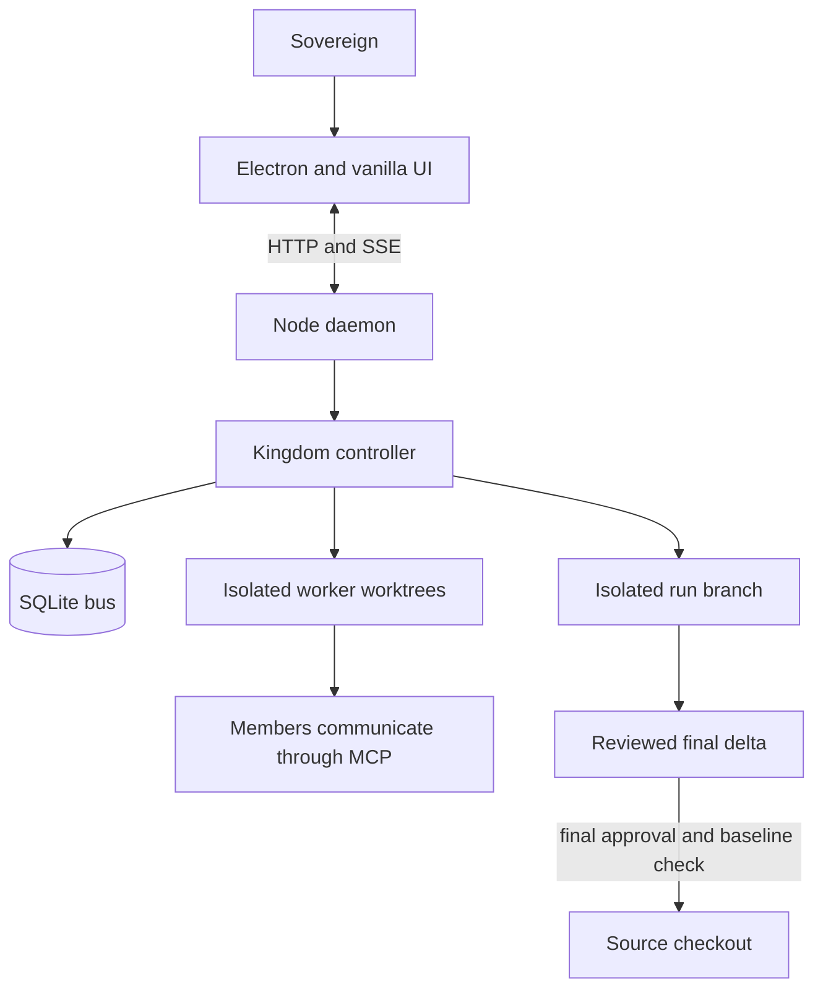
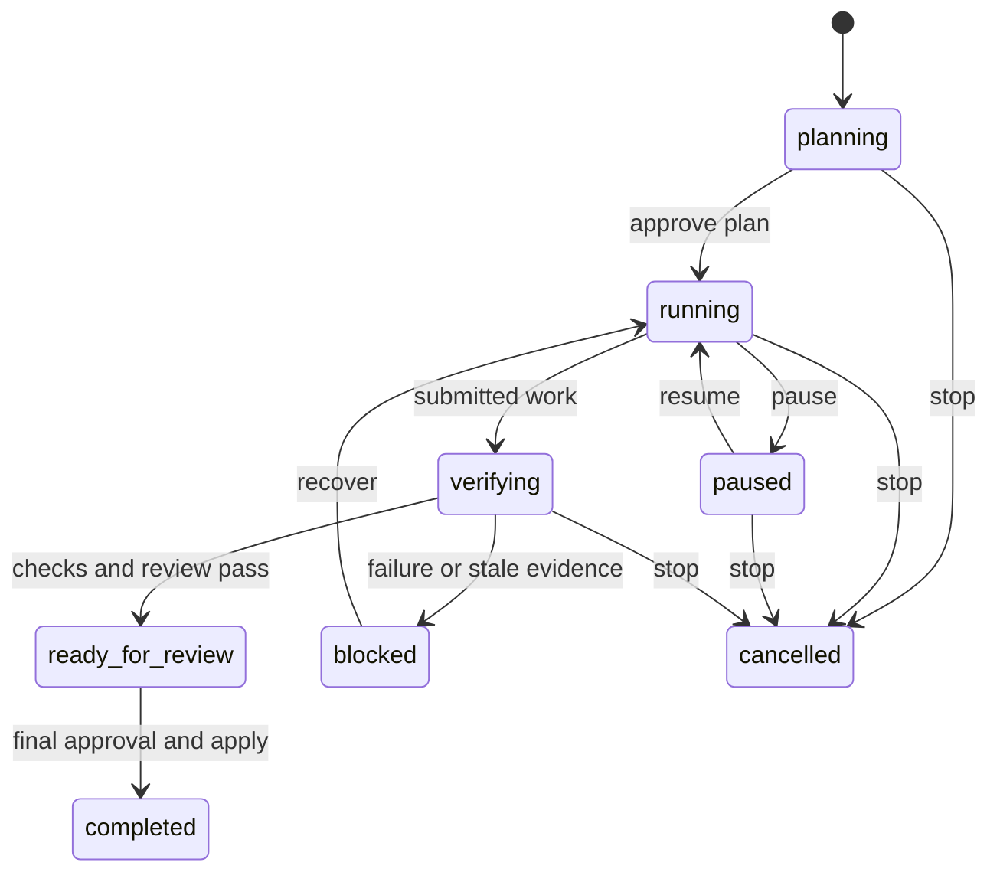

# Agentic OS handoff

## Current state

This is the sole current handoff and operating reference for this repository.
[CLAUDE.md](CLAUDE.md) holds the standing discipline and points here;
`AGENTS.md` and `docs/HANDOFF.md` are pointers, not parallel instruction sets.

On 2026-09-10 the `ui-enhancement` branch was fast-forwarded into `main` and
deleted locally. It carried five UI fixes: sidebar sections no longer overlap
under flex pressure, conversation titles truncate correctly, garbled Windows
`title` tooltips on team rows are replaced by a drawn `.hover-tip`, manual
workflow run results survive store repaints through keyed state instead of a
DOM reference, and the automation graph editor is widened to two columns. Its
`test/t-theme.js` change moved with it.

The push has since happened. Verified 2026-09-21: `main` and `origin/main` are
in sync. `origin` now carries two branches, `main` and `ui-enhancement`; the
other twenty were merged long ago and were deleted on 2026-09-21. The sovereign
chose to keep `ui-enhancement`.

Keep this trap in mind before judging a branch dead or alive: this repository
squash-merges, so a merged branch does NOT appear under
`git branch -r --merged origin/main`. Ancestry is the wrong test. The PR record
is the right one — `gh pr list --state all --json headRefName,state`.

The autonomous-improvement run system is implemented and on `main`. It has not
been demonstrated in a browser or Electron window. The Habitable pilot has not
begun.

The approved next body of work is a full interface rebuild. [PLAN.md](PLAN.md)
holds its contract and acceptance criteria. Its design system source is
Hiveory (github.com/raktim-yoddha/hiveory), adopted in full from its shipped
`app.css`. This supersedes the earlier `E:\Prototype.zip` / Cold-Call Workflow
source, retired by PLAN.md section 1 on 2026-09-17. The contract depends on
Hiveory's real token values, not on a summary of them.

**All five sections of that contract are implemented on `main`**, closed
2026-09-21. `PLAN.md` carries the table of what closed each. Its acceptance
clause is a separate matter and is still unmet: no Electron or browser session
has demonstrated any of it. Source evidence is not acceptance, and the closure
does not waive that.

## Evidence

The combined source gate passed on merged `main`: `npm.cmd test` completed
**73 suites, 4-wide, 59.3s, all passed** on 2026-09-21, after #63, #64 and #65
landed. Earlier handoffs recorded 71 suites; the
runner's array has grown since, and 73 is the count the run itself printed. The
suite count is the contract.

Durations on the same machine: 36.8s (2026-09-14), 64.1s earlier still, 179.6s
on 2026-09-21. That spread is machine load under 4-wide contention, not
regression — `test/run-all.js` documents the same effect and measures it. Do
not treat a slower run as a failure on its own.

`court self-control` failed inside the pool and passed when retried alone on
the 2026-09-21 run. The runner reports that as `flaky`, and it is the one suite
known to do this. Treat a bare pool failure there as unproven until the retry
result is read.

This is source and HTTP-level evidence. It is not visual, Electron, device,
signing, provider, or human-acceptance evidence.

## What the application does

Agentic OS is a local multi-agent coding orchestrator. An Electron shell hosts a
vanilla JavaScript UI; a Node daemon owns the court, HTTP/SSE transport, and
SQLite state; members work in Git worktrees and communicate directly through
MCP. State lives outside a target repository in its `.kingdom` directory.



The run record is durable and contains the source snapshot, approved plan,
acceptance criteria, allowed models, associated tasks, recovery history, and
revision-bound verification evidence.



## Implemented run behavior

- SQLite migrations add runs and nullable task, approval, and message run IDs
  without changing existing rows.
- Run HTTP actions and SSE snapshots expose creation, approval, pause, stop,
  resume, apply, and current/history reads.
- A run creates an isolated integration worktree. Accepted worker revisions
  merge there only after tests identify the exact checked revision.
- Run-owned `finish_task` submits work for verification; it does not mark the
  task done. Failed or stale evidence blocks the run with preserved work and a
  next action.
- Recovery history persists. Repeated unresolved worker failure becomes a
  visible blocker while unrelated work can continue.
- Pause stops new turns. Stop terminates only run-owned members. Restart
  reconciles an active run worktree before work resumes.
- Final Apply requires a ready-for-review run, final approval, a clean source
  checkout, and an unchanged captured baseline. It merges the run branch only
  after in-memory conflict checking.
- Overview, thread, and Changes show objective, work, progress, blockers,
  recovery, evidence, final review, limitations, walkthrough steps, and the
  source-state comparison.

## Key files

| File | Responsibility |
|---|---|
| [src/bus.js](src/bus.js) | SQLite schema, migrations, run lifecycle, task and approval associations. |
| [src/kingdom.js](src/kingdom.js) | Worker lifecycle, recovery, verification, run worktrees, and guarded application. |
| [src/worktree.js](src/worktree.js) | Worktree creation, revision-bound tests, conflict-safe integration, and run-branch application. |
| [src/daemon.js](src/daemon.js) | HTTP actions, run reads, snapshots, and SSE run events. |
| [src/modes.js](src/modes.js) | The mode table: crew, worktrees, merge, tasks, vault directory. Pure and self-checking. |
| [src/mcp/tasks.js](src/mcp/tasks.js) | Run-owned task submission and controller-owned closure. |
| [src/mcp/approvals.js](src/mcp/approvals.js), [src/mcp/comms.js](src/mcp/comms.js) | Run association for approvals and direct messages. |
| [ui/app.css](ui/app.css) | The whole design system. Tokens in `:root`; no literal colours outside it. |
| [ui/views/util.js](ui/views/util.js) | The shared view primitives every view composes from. |
| [ui/run.js](ui/run.js) | Run status, controls, final-review evidence, and rendering helpers. |
| [ui/store.js](ui/store.js) | Shared live run state. |
| [ui/main.js](ui/main.js), [ui/sidebar.js](ui/sidebar.js) | Shell: routing, stream lifecycle, header, and the rail. |
| [ui/views/home.js](ui/views/home.js), [ui/thread.js](ui/thread.js), [ui/views/changes.js](ui/views/changes.js) | Overview, thread context, and final-review surfaces. |
| [test/t-theme.js](test/t-theme.js) | The stylesheet contract: pinned tokens, selectors, and the literal-colour ban. |
| [test/t-pages.js](test/t-pages.js) | The view contract. Mostly behavioural guards; treat them as load-bearing. |
| [test/t-thread.js](test/t-thread.js) | Mounts the thread against a hand-rolled fake DOM with literal selectors. |
| [test/run-all.js](test/run-all.js) | A hardcoded suite array, not glob discovery. A new suite must be added by hand. |

## Commands and evidence

```powershell
npm.cmd test
npm.cmd start
node test/t-tasks.js
node test/t-daemon-boot.js
node test/t-merge.js
node test/t-tool-surface.js
node test/t-prompt.js
node test/t-theme.js
node test/t-pages.js
node ui/run.js
git diff --check
```

`npm test` deliberately excludes `t-agent.js` and `t-comms.js` because they
spend real subscription quota.

## Operating rules

1. Extend the existing owning suite for every behavior change. A test must
   fail without its fix. Run the complete no-quota suite to its terminal
   summary before committing.
2. Measure before changing thresholds. Put the measurement beside the value.
3. Degrade visibly. A failed spawn, test, merge, tool, or provider must close
   the turn with preserved work and a concrete next action.
4. Preserve dirty source checkouts. A run applies only its delta after the
   sovereign gives final approval and the captured baseline still matches.
5. Keep direct MCP member-to-member messaging, role/mode filtering, the
   framework-free renderer, and one shared stream/poll lifecycle.
6. Edit each selector at its declaration in `ui/app.css`; do not append override
   blocks. Colour lives only in the `:root` token block, as channel triples where
   alpha is needed. Keep the `#bg` wash. The removed drawn hall and avatars stay
   removed.
7. Never expose credentials in tracked configuration, UI output, logs, or this
   handoff. Codex needs `danger-full-access` to retain MCP tools; a confining
   Codex sandbox makes a member unable to report back.

## Windows and CLI traps

- Pass Codex prompts on stdin with `codex exec -`; Windows command lines have a
  hard length limit and a synchronous spawn failure otherwise prevents exit
  reporting.
- `codex exec resume` accepts a narrower flag set than `exec`; pass compatible
  configuration through `-c`.
- `agy` can change flags when it self-updates. Check `agy --help` when it exits
  silently.
- Do not use a Node heredoc to write JavaScript containing Windows backslashes.
  Use the patch tool and inspect bytes when a literal path matters.
- The Browser pane has reduced motion. Its screenshots compose only while the
  pane is visible, so visual acceptance must use computed styles or a visible
  Electron/browser session.
- Native `title` tooltips render garbled on some Windows/Chromium builds. The
  rail draws its own `.hover-tip` instead; reuse it rather than reintroducing
  `title` for long text.

## Habitable pilot

The approved first target is `E:\AI\Mobile Apps\Habitable`. Its behavior
authority is `DESIGN.md`; its `AGENTS.md` and `README.md` own operating and
build instructions. It is an offline-first Flutter app with local Drift/SQLite,
local-time scoring, history, notifications, and export/import. Preserve those
boundaries and generated-code ownership.

Before a worker changes Habitable:

1. Create a snapshot that includes tracked dirty work and relevant untracked
   source files, but excludes credentials, build output, caches, and identity.
   Record its manifest and leave the original checkout unchanged.
2. Read its specification, capture fresh `flutter analyze`, `flutter test`,
   handwritten coverage, debug APK, and emulator readiness evidence.
3. Demonstrate existing flows, audit observed defects, and prepare a finite
   backlog. Obtain initial approval for that backlog before implementation.
4. Require analysis, tests, coverage, debug APK, independent review, and
   emulator demonstration of every changed flow. Missing tooling is a visible
   blocker with preserved partial work.

An earlier assessment found a dirty Habitable checkout, 32 Dart test files, and
unresolved local Flutter/Android tool discovery. Those are historical leads, not
current proof; refresh them before the snapshot.

## Documentation ownership

- `HANDOFF.md` is the current operational source of truth.
- `PLAN.md` is the agreed product contract and acceptance criteria. It currently
  holds the interface rebuild; the superseded run-system contract is in Git
  history.
- `CLAUDE.md` holds the standing discipline and points here.
- `README.md` is the public explanation and quick start.
- `AGENTS.md` points to `CLAUDE.md`; `docs/HANDOFF.md` points here. Git history
  retains their former text. Do not recreate parallel active instruction
  documents.
- `.claude/arms/` and `.claude/skills/` are delegated by this section and hold
  no authority of their own. A router under `.claude/arms/` indexes work by
  domain: paths, and which skill and trap apply. A skill under
  `.claude/skills/` is a procedure loaded when its trigger fires, in the sense
  `src/skills.js` defines — a method invoked on purpose for the task at hand,
  not knowledge and not a standing rule. Neither may state a rule this file,
  `PLAN.md` or the source owns; where such a rule bears on the work, they name
  the file that owns it. Any contradiction with this file or `PLAN.md` is a
  defect in the subordinate document, and this file wins without argument.

## Remaining acceptance work

- **Exercise the interface in a visible browser or Electron session.** This is
  the single largest gap in this repository. `PLAN.md`'s five sections are
  implemented and their acceptance clause is unmet: nothing has demonstrated a
  run through its lifecycle, a blocked run's recovery, the collapsed rail's
  controls, the drawer at 720px with its keyboard path, or reduced-motion
  behavior. Screenshots alone are insufficient, and the Browser pane cannot
  supply this — see the trap above about its reduced motion and pane-visible
  compositing.
- Watch the two fixes in `6bec8c8` in a live court. Both are proven by source
  tests only: that the crown's replies now reach an orchestrator whose name is
  "orchestrator", and that releasing a departed member's work names the
  verification it discarded instead of silently collapsing it.
- Run the Habitable pilot preparation above. Its backlog needs approval before
  implementation starts; physical-device, signing, store release, and iOS remain
  separate from the pilot unless explicitly added.
- Validate live subscription-model pool behavior without paid API fallback when
  a real approved run is started.
