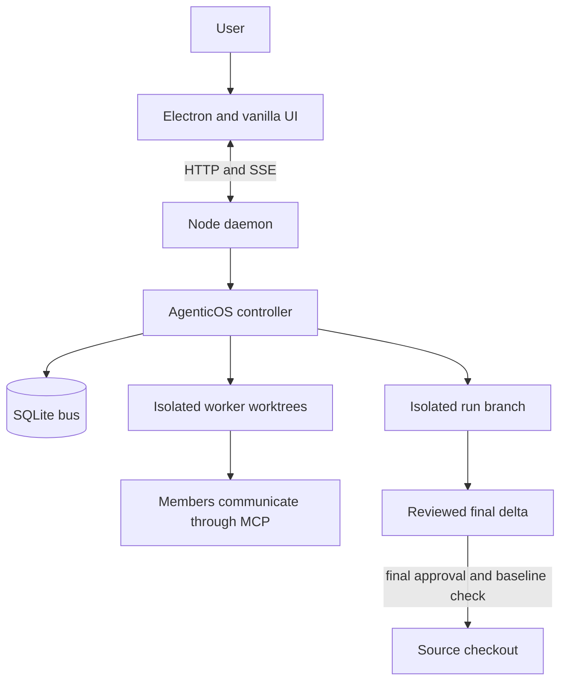
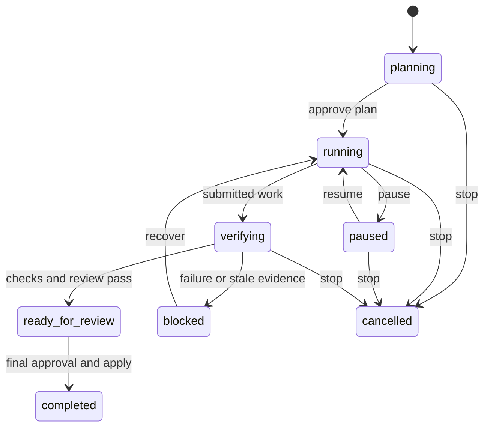

# Agentic OS handoff

## Current state (2026-10-21)

`main` carries PR #88 (`ce2937d`: the T3 redesign, the 18-role roster, session
features, CLI adapters and the AgenticOS rename) plus the two desktop fixes
after it. Earlier dated sections of this file were history and live in Git.

The `cleanup` branch, cut from `main` at `e26a975`, removes the rename's
one-time migration layer (`src/legacy.js`, `src/legacy-boot.js`, the
`scripts/rename/` codemod and every `KINGDOM_*`/`.kingdom` fallback),
de-duplicates shared helpers, prunes stale docs, and re-does each screen to
the "Agentic OS — T3 Code style" design canvas. `PLAN.md` holds its contract
and evidence. A pre-rename state folder is no longer migrated: start from
current names. The seeded browser audit also found and fixed a real defect:
the thread rendered every pending approval as a raw JSON bubble
(`test/t-thread.js` now fails without the fix).

**Gate on `cleanup`: 101 suites** (102 less `t-legacy-migrate.js`), every one
passing except `t-electron.js` (no display here). Commits were made with
`--no-verify` for that reason alone.

Trap found doing it: a demo daemon started in this container picks up the
container's own `claude` CLI and takes real orchestrator turns. Put stub
`claude`/`codex`/`agy`/`opencode`/`cursor-agent` scripts first on `PATH`
before seeding a team for screenshots.

### Desktop verification (2026-10-21, on `main`)

PR #88 is merged as `ce2937d` on `main`; the unmerged-branch statements in
the historical sections below predate that merge. The desktop's divergent
design/preview work is preserved on `codex/preserved-desktop-20261021` and
`codex/desktop-before-sync-20261021`, plus a verified pre-setup Git bundle.

Fresh Windows gate after the live-discovered fixes: **102 suites, 4-wide,
156.5s; all suites passed**, including real Chromium geometry and Electron
acceptance. Chromium installation is now an explicit Windows CI step.

Real Codex (`gpt-6.1-sol`), agy (`gemini-3.8-flash-low`), OpenCode
(`opencode/big-pickle`) and native Windows Cursor Agent (`auto`) each passed
a two-turn response/resume check against one saved session. Cursor was
installed from its official Windows installer; its supported JavaScript
binary override is configured per user. This is live provider evidence,
separate from the adapter fixtures.

Live MCP discovery exposed two defects: schema compaction converted a
property named `description` to a string, which Cursor rejected, and OpenCode
never loaded its private `.opencode.json`. Compaction now changes only
description strings; OpenCode gets `OPENCODE_CONFIG`. Their owning regression
tests fail without the fixes, and real Cursor lists the team tools while
real OpenCode reports the server connected. A further reproducible panel
failure came from verification of an older submission attaching to a newer
run; verification now retains the run captured before its asynchronous work
and excludes submissions predating that run.

Actual legacy home/repository state was backed up and migrated. Both SQLite
databases pass integrity checks; every original message, event, task and
conversation ID remains, message text is unchanged, and token bytes match
the backup. The home database retains 107 messages and eight conversations;
its two additional events record config and roster migration. Both migrated
workspace configurations now have the 18-role roster and verified backends.

The real 18-role acceptance run completed with controller assistance. Cursor
implemented the finite greeting fixture; Codex independently tested the exact
submitted revision, including a red/green sensitivity check; OpenCode reviewed
that revision and returned `REVIEW_ACCEPT`. Fresh controller tests passed,
the verified revision was integrated into a follow-up run and applied, and
tests passed in the resulting source checkout. Earlier autonomous attempts
blocked on short watchdogs and on testing an unchanged worker baseline; their
history is preserved. This is not evidence of unattended end-to-end completion.

The Windows installer was exercised from the preserved legacy installer to
the renamed app: exit 0, the same uninstall GUID and installation directory,
one installed app, and the legacy executable replaced. The installed app was
opened and inspected with the actual eight-conversation workspace.

The real profile check found another source-only-test gap: Electron's
`getPath('userData')` eagerly creates that directory, so the old startup call
made the migration see both copies and leave the old profile behind. An
isolated Electron probe reproduced it. Startup now computes the destination
without reading `userData`, preserving an explicit command-line override.
The migration regression test fails without the fix. The final installer was
updated and first-launch migration then moved the actual legacy profile;
the original pet settings match the backup, the legacy folder is gone, and
installed runtime files hash-match the tested source. Test-created profiles
and the pre-migration backups were preserved separately.

## What the application does

Agentic OS is a local multi-agent coding orchestrator. An Electron shell hosts a
vanilla JavaScript UI; a Node daemon owns the team, HTTP/SSE transport, and
SQLite state; members work in Git worktrees and communicate directly through
MCP. State lives outside a target repository in its `.agenticos` directory.



The run record is durable and contains the source snapshot, approved plan,
acceptance criteria, allowed models, associated tasks, recovery history, and
revision-bound verification evidence.



## Implemented run behavior

- SQLite migrations add runs and nullable task, approval, and message run IDs
  without changing existing rows.
- Run HTTP actions and SSE snapshots expose creation, approval, pause, stop,
  resume, apply, and current/history reads.
- A run creates an isolated integration worktree. Accepted worker revisions
  merge there only after tests identify the exact checked revision.
- Run-owned `finish_task` submits work for verification; it does not mark the
  task done. Failed or stale evidence blocks the run with preserved work and a
  next action.
- Recovery history persists. Repeated unresolved worker failure becomes a
  visible blocker while unrelated work can continue.
- Pause stops new turns. Stop terminates only run-owned members. Restart
  reconciles an active run worktree before work resumes.
- Final Apply requires a ready-for-review run, final approval, a clean source
  checkout, and an unchanged captured baseline. It merges the run branch only
  after in-memory conflict checking.
- Overview, thread, and Changes show objective, work, progress, blockers,
  recovery, evidence, final review, limitations, walkthrough steps, and the
  source-state comparison.

## Key files

| File | Responsibility |
|---|---|
| [src/bus.js](src/bus.js) | SQLite schema, migrations, run lifecycle, task and approval associations. |
| [src/agenticos.js](src/agenticos.js) | Worker lifecycle, recovery, verification, run worktrees, and guarded application. |
| [src/worktree.js](src/worktree.js) | Worktree creation, revision-bound tests, conflict-safe integration, and run-branch application. |
| [src/daemon.js](src/daemon.js) | HTTP actions, run reads, snapshots, SSE run events, and bearer-token auth for a non-loopback bind. |
| [src/snapshot.js](src/snapshot.js) | Target-repo snapshot/restore before a worker touches it (Habitable pilot step one). Read-only against the repo it snapshots. |
| [src/evidence.js](src/evidence.js) | Exports one self-contained folder per completed run: objective, diff, tests, reviews, cost, timeline, and an optional pilot section. |
| [src/teams.js](src/teams.js) | Multiple teams at once (issue #42): the `~/.agenticos/teams.json` registry — register/list/prune, port picking, lockfile + atomic write. Pure core is self-checking (`node src/teams.js`). |
| [electron/teams-launch.js](electron/teams-launch.js) | The pure decision behind a relaunch or `app.requestSingleInstanceLock`'s second-instance event: focus a live team or start a fresh one. Self-checking (`node electron/teams-launch.js`); see `test/t-teams-launch.js`. |
| [ui/views/teams.js](ui/views/teams.js) | The team switcher panel in Settings' Repository tab. Degrades to a plain note outside Electron (`window.agenticosShell` absent). |
| [src/pilot-doctor.js](src/pilot-doctor.js) | Habitable pilot step two: doctor-style flutter/dart/adb/SDK/emulator detection. `node src/pilot-doctor.js` for a real report; every dependency is injectable for `test/t-pilot-doctor.js`. |
| [src/pilot-evidence.js](src/pilot-evidence.js) | Habitable pilot steps two and four: the evidence gate — `flutter analyze`, `flutter test --coverage`, a debug APK build, blocked cleanly on missing tooling. Fakes-only in tests; never points at the real Habitable checkout. |
| [test/isolate-registry.js](test/isolate-registry.js) | Shared test helper: gives a daemon-spawning suite an isolated `AGENTICOS_TEAMS_REGISTRY` when nothing upstream (`test/run-all.js`) already set one — never touches the real `~/.agenticos/teams.json`. |
| [src/modes.js](src/modes.js) | The mode table: crew, worktrees, merge, tasks, vault directory. Pure and self-checking. |
| [src/mcp/tasks.js](src/mcp/tasks.js) | Run-owned task submission and controller-owned closure. |
| [src/mcp/approvals.js](src/mcp/approvals.js), [src/mcp/comms.js](src/mcp/comms.js) | Run association for approvals and direct messages. |
| [ui/views/usage.js](ui/views/usage.js) | Usage, including Run spend: one run's ledger from `/api/runSpend` against `maxRunUsd`. |
| [ui/notify.js](ui/notify.js) | Desktop notifications, including run state changes; covered by `test/t-notify.js`. |
| [ui/app.css](ui/app.css) | The whole design system. Tokens in `:root`; no literal colours outside it. |
| [ui/routes.js](ui/routes.js) | The pure route table: pages, tabs, and the aliases that send a retired address to its new home. `test/t-routes.js`. |
| [ui/views/tabs.js](ui/views/tabs.js) | The tab host for Inbox, Team and Knowledge: each body keeps its own mount and cleanup. |
| [ui/palette.js](ui/palette.js) | Ctrl K: every page and run, with a pure matcher. `test/t-palette.js`. |
| [ui/inspector.js](ui/inspector.js) | The run's session inspector; `progressSteps` is pure. `test/t-inspector.js`. |
| [ui/fonts](ui/fonts) | Inter and JetBrains Mono (variable woff2, latin) and their OFL licences. |
| [ui/views/util.js](ui/views/util.js) | The shared view primitives every view composes from. |
| [ui/run.js](ui/run.js) | Run status, controls, final-review evidence, and rendering helpers. |
| [ui/store.js](ui/store.js) | Shared live run state. |
| [ui/main.js](ui/main.js), [ui/sidebar.js](ui/sidebar.js) | Shell: routing, stream lifecycle, header, and the rail. |
| [ui/views/home.js](ui/views/home.js), [ui/thread.js](ui/thread.js), [ui/views/changes.js](ui/views/changes.js) | Overview, thread context, and final-review surfaces. |
| [test/t-theme.js](test/t-theme.js) | The stylesheet contract: pinned tokens, selectors, and the literal-colour ban. |
| [test/t-pages.js](test/t-pages.js) | The view contract. Mostly behavioural guards; treat them as load-bearing. |
| [test/t-thread.js](test/t-thread.js) | Mounts the thread against a hand-rolled fake DOM with literal selectors. |
| [test/t-electron.js](test/t-electron.js) | Launches the real Electron binary with `playwright-core` and reads what Chromium painted. Sections: the shell, the run lifecycle, a blocked run's recovery, the collapsed rail, the 720px drawer by keyboard, and reduced motion. |
| [src/inbox.js](src/inbox.js) | Pure: the ranked in-app inbox, its text brief, and the team digest. Shared by `/api/inbox` and the `digest` workflow node. |
| [src/workflow-templates.js](src/workflow-templates.js) | The built-in automations the Automations Templates shelf installs as ordinary, editable workflows. |
| [ui/views/tasks.js](ui/views/tasks.js) | The Tasks view: the user's own list and the team queue's controls. |
| [test/run-all.js](test/run-all.js) | A hardcoded suite array, not glob discovery. A new suite must be added by hand. |

## Commands and evidence

```powershell
npm.cmd test
npm.cmd start
node test/t-tasks.js
node test/t-daemon-boot.js
node test/t-merge.js
node test/t-tool-surface.js
node test/t-prompt.js
node test/t-theme.js
node test/t-pages.js
node test/t-electron.js
node ui/run.js
git diff --check
```

`npm test` deliberately excludes `t-agent.js` and `t-comms.js` because they
spend real subscription quota.

## Operating rules

1. Extend the existing owning suite for every behavior change. A test must
   fail without its fix. Run the complete no-quota suite to its terminal
   summary before committing.
2. Measure before changing thresholds. Put the measurement beside the value.
3. Degrade visibly. A failed spawn, test, merge, tool, or provider must close
   the turn with preserved work and a concrete next action.
4. Preserve dirty source checkouts. A run applies only its delta after the
   user gives final approval and the captured baseline still matches.
5. Keep direct MCP member-to-member messaging, role/mode filtering, the
   framework-free renderer, and one shared stream/poll lifecycle.
6. Edit each selector at its declaration in `ui/app.css`; do not append override
   blocks. Colour lives only in the `:root` token block, as channel triples where
   alpha is needed. Keep the `#bg` wallpaper layer. The removed drawn hall and
   avatars stay removed.
7. Never expose credentials in tracked configuration, UI output, logs, or this
   handoff. Codex needs `danger-full-access` to retain MCP tools; a confining
   Codex sandbox makes a member unable to report back.

## Windows and CLI traps

- Pass Codex prompts on stdin with `codex exec -`; Windows command lines have a
  hard length limit and a synchronous spawn failure otherwise prevents exit
  reporting.
- `codex exec resume` accepts a narrower flag set than `exec`; pass compatible
  configuration through `-c`.
- `agy` can change flags when it self-updates. Check `agy --help` when it exits
  silently.
- Do not use a Node heredoc to write JavaScript containing Windows backslashes.
  Use the patch tool and inspect bytes when a literal path matters.
- The Browser pane has reduced motion. Its screenshots compose only while the
  pane is visible, so visual acceptance must use computed styles or a visible
  Electron/browser session.
- Native `title` tooltips render garbled on some Windows/Chromium builds. The
  rail draws its own `.hover-tip` instead; reuse it rather than reintroducing
  `title` for long text.

## Habitable pilot

The approved first target is `E:\AI\Mobile Apps\Habitable`. Its behavior
authority is `DESIGN.md`; its `AGENTS.md` and `README.md` own operating and
build instructions. It is an offline-first Flutter app with local Drift/SQLite,
local-time scoring, history, notifications, and export/import. Preserve those
boundaries and generated-code ownership.

Before a worker changes Habitable:

1. ~~Create a snapshot that includes tracked dirty work and relevant untracked
   source files, but excludes credentials, build output, caches, and identity.
   Record its manifest and leave the original checkout unchanged.~~ Implemented
   2026-09-22: `src/snapshot.js`'s `snapshotRepo`/`restoreSnapshot`, proven
   against the acceptance scenario verbatim in `test/t-snapshot.js` — tracked
   edit, tracked deletion, untracked source (flat and nested), a secret, and a
   build directory. Source evidence only; never run against the real Habitable
   checkout.
2. Read its specification, capture fresh `flutter analyze`, `flutter test`,
   handwritten coverage, debug APK, and emulator readiness evidence.
3. Demonstrate existing flows, audit observed defects, and prepare a finite
   backlog. Obtain initial approval for that backlog before implementation.
4. Require analysis, tests, coverage, debug APK, independent review, and
   emulator demonstration of every changed flow. Missing tooling is a visible
   blocker with preserved partial work.

An earlier assessment found a dirty Habitable checkout, 32 Dart test files, and
unresolved local Flutter/Android tool discovery. Those are historical leads, not
current proof; refresh them before the snapshot.

## Documentation ownership

- `HANDOFF.md` is the current operational source of truth.
- `PLAN.md` is the agreed product contract and acceptance criteria. Closed
  contracts are in Git history, not in the file.
- `CLAUDE.md` holds the standing discipline and points here.
- `README.md` is the public explanation and quick start.
- `AGENTS.md` points to `CLAUDE.md`. Git history retains former documents. Do not recreate parallel active instruction
  documents.
- `.claude/arms/` and `.claude/skills/` are delegated by this section and hold
  no authority of their own. A router under `.claude/arms/` indexes work by
  domain: paths, and which skill and trap apply. A skill under
  `.claude/skills/` is a procedure loaded when its trigger fires, in the sense
  `src/skills.js` defines — a method invoked on purpose for the task at hand,
  not knowledge and not a standing rule. Neither may state a rule this file,
  `PLAN.md` or the source owns; where such a rule bears on the work, they name
  the file that owns it. Any contradiction with this file or `PLAN.md` is a
  defect in the subordinate document, and this file wins without argument.

## Remaining acceptance work

- That 2026-09-21 demonstration was a one-time manual session, not a repeatable
  suite. `test/t-electron.js` (recovered 2026-09-22) turns the shell and the run
  lifecycle into automated Electron evidence that runs on every `npm test`.
  ~~Four clause items are still manual-only.~~ Done 2026-09-25: a blocked
  run's recovery, the collapsed rail, the 720px drawer's keyboard path and
  reduced motion are sections 3-6 of that suite. They were proved in real
  Chromium here, then passed in Electron on Windows CI (PR #82, head
  `49f81ed`).
- Watch the two fixes in `6bec8c8` in a live team. Both are proven by source
  tests only: that the system's replies now reach an orchestrator whose name is
  "orchestrator", and that releasing a departed member's work names the
  verification it discarded instead of silently collapsing it.
- Run the Habitable pilot preparation above. Its backlog needs approval before
  implementation starts; physical-device, signing, store release, and iOS remain
  separate from the pilot unless explicitly added.
- Validate live subscription-model pool behavior without paid API fallback when
  a real approved run is started.
- Multiple teams at once (issue #42, `functional-revamp`, 2026-09-23) needs
  Electron and Windows acceptance: the single-instance lock, per-port windows,
  the native "End this workspace?" confirmations, and media-permission scoping per
  team window were never run — this environment cannot launch Electron. A
  developer machine must exercise: two repositories open at once, a relaunch
  focusing the right team instead of starting a stray daemon, and the
  switcher's open/end actions in a real window.
- The Habitable pilot's tooling doctor and evidence gate (steps two and four,
  `functional-revamp`, 2026-09-23) are built and tested with fakes only. They
  have never run against real Flutter/Android tooling or the real Habitable
  checkout, and must not until HANDOFF.md step 3 (demonstrate, audit, get a
  finite backlog approved) has actually happened.
