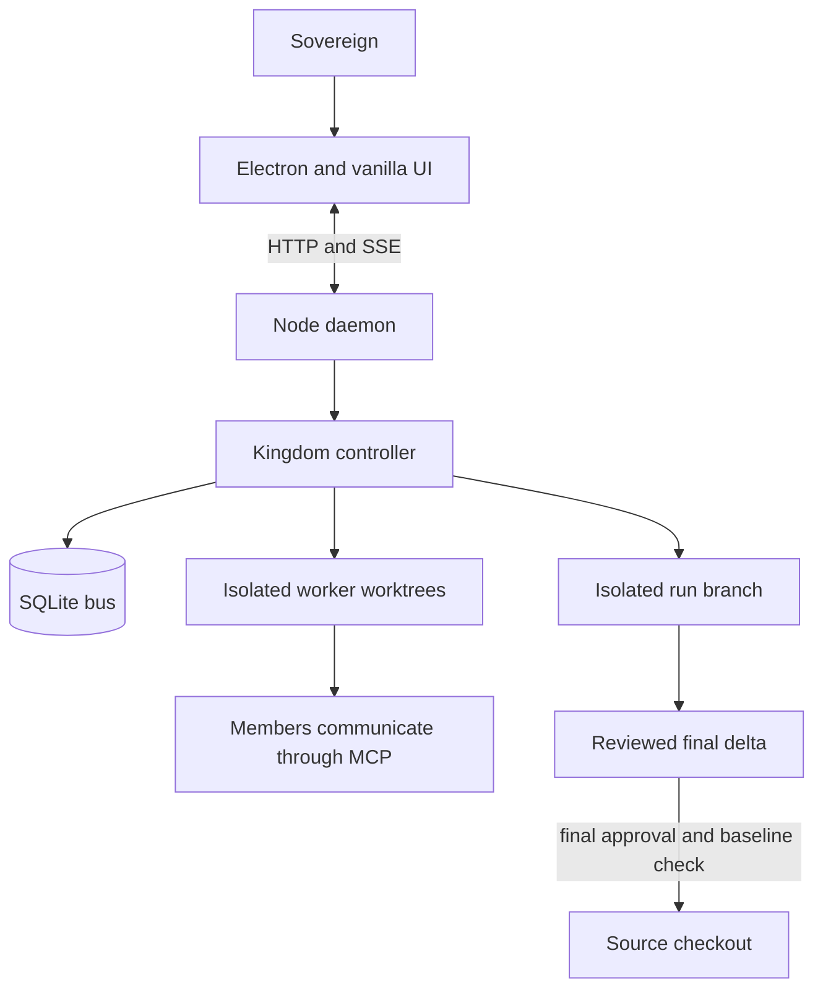
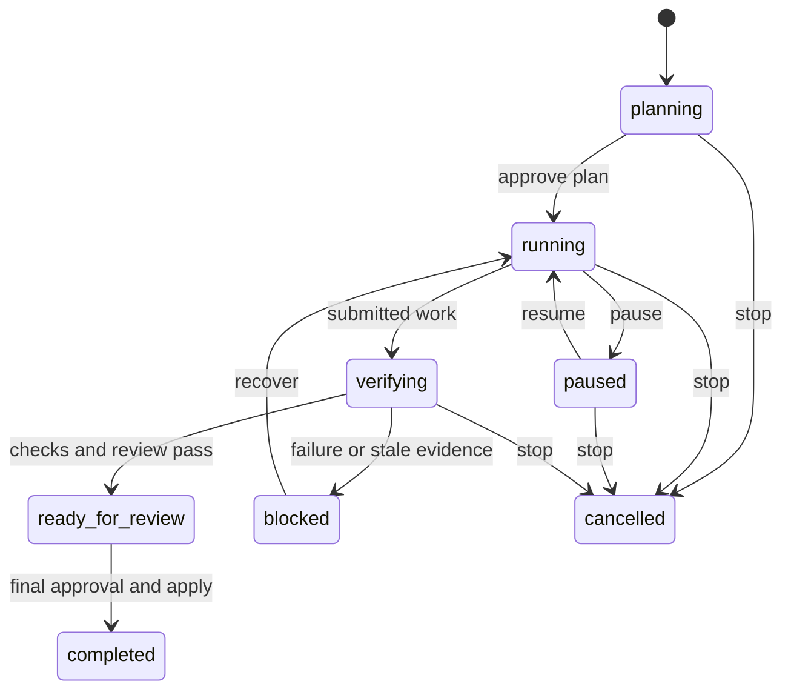

# Agentic OS handoff

## Current state (functionality, 2026-10-21)

The `functionality` branch is cut from `T3-code` at `e730bb6`, so it carries
the T3 redesign below as well. It merges four parallel threads, each pushed as
its own branch and merged with `--no-ff`. It is **not merged to `main`**, and
no PR has been opened. Each thread's report owns its detail: what changed, the
decisions and deviations it made, and the evidence it holds and lacks.

| Thread | Branch | Report | In short |
|---|---|---|---|
| f1 performance | `f1-performance` | [f1-performance.md](plans/functionality/f1-performance.md) | Codex MCP listing and compact-JSON commits brought in. `campaigns()` survives `clearSpend()` (`spentUsdCleared`). `test/cleanup.js` stops the `<tmp>/.kingdom` leak. The vault watcher is released on stdin close, which fixed an MCP-process leak on Linux and took the vault suite from about 36s to 7s. |
| f2 design | `f2-design` | [f2-design.md](plans/functionality/f2-design.md) | The court goes from 107 to 18 tiered roles (`src/roster.js`). The 90 retired roles are in `roles-library.json`. Existing courts migrate on launch (`Kingdom#migrateRoster`, `test/t-roster-migrate.js`), and members with work in flight are kept until idle. The orchestrator prompt drops by about 3.4KB. |
| f3 session | `f3-session` | [f3-session.md](plans/functionality/f3-session.md) | Context-window meter (`contextWindows` in config, claude models only). Compact session (`POST /api/compactSession`, through `recycleAgent`). `runs.lead` (`schema:runs:lead:v1`). A `spend_ledger` table and `spendByDay`. The T3 inspector and Overview show all of them. |
| f4 CLI | `f4-cli` | [f4-cli.md](plans/functionality/f4-cli.md) | `codex/cli-integrations` integrated with 19 review defects fixed. Cursor added. Freebuff dropped (it was a stub). Doctor no longer spends quota on a live model call. |

Specs that are not built yet are in
[plans/functionality/specs.md](plans/functionality/specs.md): Remote
control, Browser preview and Design canvas. The Design canvas decisions are
recorded there; the other two still have open questions. The full rename
away from Kingdom-era words is decided in [docs/RENAME.md](docs/RENAME.md)
(its 2026-10-21 revision wins) and is the next step, on a `rename` branch.

**Gate after the last merge (`56b64be`): 101 suites, 4-wide, 41.7s.** Every
suite passed except `t-electron.js`, which cannot open a window in this
display-less Linux container (xvfb was tried and hung). Each thread commit
went in with `--no-verify` for that reason alone, and its message says so.
The container runs Node 22.22.0, but `package.json` asks for `>=24`.

**Not held:** Electron or Windows CI on this branch. Any real Cursor,
opencode or agy CLI. A real court run on the 18-role roster. A migration of
a real user's config. Context-window figures for non-claude models; f2 put
every specialist on codex, so their meters read "window unknown". The user's
own acceptance.

## Current state (T3-code, 2026-10-21)

The `T3-code` branch (nine commits on `main` at `62561d3`, the last being these docs) carries the redesign
the sovereign asked for from the Claude design canvas "Agentic OS - T3 Code
style". It is **not merged**; no PR has been opened. [PLAN.md](PLAN.md)'s "T3
Code redesign" section is the contract, the decisions made without asking, the
commit table and the evidence. In short:

- Dark, flat, neutral tokens replace the paper theme; the glass layer is gone.
  Inter and JetBrains Mono are bundled in `ui/fonts`.
- The rail is the brand plus Inbox, Team, Knowledge and Automations, then the
  runs list. Everything else is a tab (`ui/routes.js`, `ui/views/tabs.js`), a
  Settings section, a run chip, or one Ctrl K away (`ui/palette.js`). A retired
  address is an alias; `test/t-routes.js` fails if one lands on Overview.
- A run is the orchestrator's thread: Session, Diff and Tasks chips, and a
  session inspector (`ui/inspector.js`) read only from state the daemon streams.
- **Not built, by decision:** the canvas's Browser preview, Design canvas,
  context-window meter, Compact session and Remote control. *(The meter and
  Compact session were later built on `functionality` by f3. The other three
  are specced in `plans/functionality/specs.md`.)*
- **Held:** 95 suites in the Linux container, all passing but `t-electron.js`
  (no display); a seeded-court audit of every route at three viewports in real
  Chromium. **Not held:** Electron and Windows (push the branch and read the
  `windows-latest` job), and the sovereign's acceptance of the look.

Where this file below still says paper, glass or More tools, it describes what
`main` was; those paragraphs are history, marked where they are false.

## Current state

This is the sole current handoff and operating reference for this repository.
[CLAUDE.md](CLAUDE.md) holds the standing discipline and points here;
`AGENTS.md` and `docs/HANDOFF.md` are pointers, not parallel instruction sets.

On 2026-09-10 the `ui-enhancement` branch was fast-forwarded into `main` and
deleted locally. It carried five UI fixes: sidebar sections no longer overlap
under flex pressure, conversation titles truncate correctly, garbled Windows
`title` tooltips on team rows are replaced by a drawn `.hover-tip`, manual
workflow run results survive store repaints through keyed state instead of a
DOM reference, and the automation graph editor is widened to two columns. Its
`test/t-theme.js` change moved with it.

Verified 2026-09-25 (`git ls-remote --heads origin`, after #82 landed):
`origin` carries `main`, `claude/peaceful-bohr-c3dfn8` (PRs #80 and #81, both
on `main` as `c6f3b18` and `ca8dabf`; the branch was restarted from `main` for
the post-#82 cleanup) and `feature-implementation` (PR #82, on `main` as
`544fe41`). `claude/confident-brown-trd7w2` is gone. `ui-enhancement` and every feature branch named
below (`ui-revamp`, `functional-revamp`, `chore/recover-electron-harness`, the
`fix/issue-*` branches) are gone. Their work is on `main`: each PR head from
#71-#79 is an ancestor of `origin/main`. Those PRs read "closed", not
"merged", on GitHub because they were merged locally.

Keep this trap in mind before judging a branch dead or alive: this repository
squash-merges, so a merged branch does NOT appear under
`git branch -r --merged origin/main`. Ancestry is the wrong test. The PR record
is the right one — `gh pr list --state all --json headRefName,state`.

The autonomous-improvement run system is implemented and on `main`, and as of
2026-09-21 it has been driven through its lifecycle in a live browser and in the
Electron shell. The Habitable pilot has not begun.

The approved next body of work is a full interface rebuild. [PLAN.md](PLAN.md)
holds its contract and acceptance criteria.

**Its design system source reversed on 2026-09-21.** The sovereign supplied
`Prototype.zip` — the Cold-Call Workflow kit that PLAN.md section 1 had retired
on 2026-09-17 — and asked for the app redesigned on it outright. That was the
system the app ran until 2026-10-21 (paper, not a dark shell); the `T3-code`
branch replaces it. Three grounds (`#f7f1e7`,
`#ebe1d2`, `#fffdf9`), one teal accent doing brand and primary interactive
together, the kit's product scale rather than its marketing one (16px card,
12px control, no pill buttons), and metadata set in mono, uppercase and tracked
— which is the exact inverse of the Hiveory rule it replaced. Hiveory's spec
stays in PLAN.md section 1 as the record of what was agreed on 2026-09-17; it
is no longer what the app implements. `ui/app.css`'s `:root` comment says the
same thing at the code, and `test/t-theme.js` pins every value.

Before reading a colour out of the kit: it publishes its contrast ratios
against `--paper` only, and this app's rail and every section sit on
`--paper-deep`. Two tokens are deliberately darker than the kit's
(`--muted`/`--faint` `#55635e`, not `#5c6c66`; `--tone-attention` `#9e4239`,
not `#af4a3f`) so they clear 4.5:1 on the ground they actually sit on. The
suite fails if either is "restored".

**All five sections of that contract are implemented on `main`**, closed
2026-09-21. `PLAN.md` carries the table of what closed each, and now also the
table of how its acceptance clause was met: one live session on 2026-09-21 drove
a run through its lifecycle, recovered a blocked run, exercised the collapsed
rail, the 720px drawer with its keyboard path, and reduced motion — first in a
browser, then confirmed inside Electron.

The redesign re-ran that whole walk on 2026-09-21 and it paid for itself again:
twenty-eight sub-AA contrast pairings, `.conversation-open` at 210x24 and
`.sidebar-repo` at 227x27 against the enforced 44px, the collapsed rail's nav
buttons at 34x44 inside the rail's own 16px inset, the 720px drawer's mode
section reporting 287x0 while its pills painted through the Overview row, and
that drawer running 122px past the viewport and squashing the conversation list
to 287x0 — no way to reach a conversation at all. Every one fixed at its
declaration and pinned. Re-verified live: 14-view audit clean at 1440x900,
collapsed rail 47x44 throughout, Tab trapped across 26 presses in the drawer
with Escape returning focus to Menu, reduced motion correct at both `reduce`
and `no-preference`.

That session is also the strongest argument in this repository for not trusting
source evidence. The interface had 73 green suites and eight visible layout
defects, six of them one root cause: a CSS grid distributes leftover height
across every row it created, so headings floated mid-section and a conversation
row stood 165px tall with 49px left for its title. `align-content: start` at each
shared declaration fixed all six; `fix/live-layout-defects` carries them with
tests that pin the measured numbers.

**2026-09-23: a glass layer was added on top of the paper palette (removed on
`T3-code`, 2026-10-21)**, on the
`ui-revamp` branch, since merged to `main`. PLAN.md's new "UI revamp —
paper with glass (2026-09-23)" section is the contract and its acceptance
evidence; the summary: `#header`, `#sidebar` (rail and drawer), `#composer`,
`.hover-tip`, and the drawer scrim gained
`backdrop-filter: blur(20px) saturate(1.6)` and a translucent background at
one of two new alphas (`--glass-chrome-alpha: .90`, `--glass-panel-alpha:
.97`), both computed against a worst-case fully-black wallpaper ground so
every text pairing still clears 4.5:1 there. `.view-section` (cards) stay
flat, unchanged. `test/t-theme.js` intentionally replaces a 2026-09-21 guard
that pinned `backdrop-filter` absent from the whole stylesheet; that guard
predates this direction and is superseded by it, not weakened.

**That first pass audited an empty demo court, and it hid real defects.**
Corrected the same session, in a second round recorded in PLAN.md's "UI
revamp round 2": seeded the demo court with a real objective, a run that
travelled through `blocked` with recovery history plus a second completed
run in history, tasks in every state, three approvals, twelve conversations,
a thread with a real code block and a deliberately long URL, and a real
three-file diff from a summoned peasant's worktree
(`/home/user/wt-ui-shots/seed.mjs`), then re-audited at 1440x900, 1280x720,
and 720x900. Found and fixed five more defects invisible against an empty
state: the rail's footer and conversation list clipped under real height
pressure at 1280x720 (`.sidebar-scroll`); the page heading carried an
identical, information-free eyebrow and the marketing type scale on all 14
views (PLAN.md section 1 requires the product scale); the glass from the
first round was invisible with no wallpaper set, because blurring a flat
colour is indistinguishable from not blurring it (`--wash` gives the paper
itself real tonal variation); Settings' Models & efficiency and Notifications
tabs drew a card nested inside a panel (an outer `.view-section` flush
against its own `.settings-group` fieldsets); and the header's mode switcher
visibly dominated the header with a permission blurb `test/t-theme.js`
already banned once under a different tag name. Also traced and fixed: a
fenced code block in a thread message had no styling at all (bare browser
`<pre><code>` defaults) — `ui/markdown.js` already rendered it correctly, the
gap was purely that `ui/app.css` never styled the result. Checked and left
alone, with reasons recorded in PLAN.md: Settings' tab row (already scrolls,
does not wrap), the Changes diff view (reads well against a real diff), and
Overview's "Verified deliverables" card (measured 173px in real Chromium
against "Current work"'s 350px — a screenshot misreading, not a stretched
card; `align-items: start` was already correct).

## Current state (functional-revamp, 2026-09-23)

Two pieces of the 2026-09-23 "functional revamp" landed on `main` from
`functional-revamp`: multiple courts at once (closes GitHub issue #42) and Habitable pilot
readiness (tooling detection plus an evidence gate, source-side only). Full
contract and acceptance evidence: `PLAN.md`'s "Functional revamp" section.

**Multiple courts reverses the 2026-09-22 decision below** ("Running several
courts... the sovereign declined it for this round") — the sovereign asked for
it explicitly the next day. One daemon process per repository, each on its own
port, tracked in `~/.kingdom/courts.json` (`src/courts.js`); a daemon refuses a
second live court for the same repo and names the port it is on; a busy pinned
port is a clean, visible error; an unpinned port is picked automatically from
7777 up. Electron gets `app.requestSingleInstanceLock()` and per-port windows
(`electron/courts-launch.js`, `electron/main.js`); Settings' Repository panel
gets a switcher (`ui/views/courts.js`) that opens or starts another repo's
court without ending the current one, and no longer waits for attachRepo to
fail before offering "End court and switch…" (issue #42's fail-first
complaint). **Electron itself and Windows were not exercised** — this
environment cannot launch Electron; that acceptance work is still owed.

**Review fix, same day: a LIVE attach bypassed the registry.**
`registerCourt` only ran once, at daemon boot, with whatever repo was known
then — a repo-less daemon that later got `POST /api/attachRepo` (or the
saved-repo re-attach at boot) never updated or conflict-checked the registry.
That let two daemons end up serving the SAME repository with no refusal, and
left a stale `repo: null` row the switcher could never match. Fixed: the
attach handler now claims the repo under the registry's lock BEFORE
`kingdom.attachRepo` does any work, refuses naming the other court's port on
conflict, and rolls back the claim if the attach itself then fails.
`test/t-registry-attach.js` (two real daemons) covers it, confirmed to fail
without the fix.

**Review fix, same day: the test gate itself wrote to the real registry.**
Suites that spawn a real daemon (`t-assets`, `t-control`, `t-csrf`,
`t-daemon-boot`, `t-daemon-conversations`, `t-doctor-api`, `t-multi-court`,
`t-panels`, `t-uploads`, `t-registry-attach`) were registering into the REAL
`~/.kingdom/courts.json` on whatever machine ran `npm test` — on the
sovereign's machine, running the gate while the app is open would have
mutated their live registry. Fixed at the runner: `test/run-all.js` now
spawns every suite with its own isolated `KINGDOM_COURTS_REGISTRY` (one
per-suite temp file, so concurrent suites never share or race over one), and
`test/isolate-registry.js` gives the same isolation to a suite run standalone
(`node test/t-x.js`). `test/t-registry-isolation.js` is the guard, proving a
daemon spawned this way never touches the real file. The file that had
already been created on this machine by earlier, unisolated runs was deleted
once the fix was verified.

Habitable pilot readiness: `src/pilot-doctor.js` (flutter/dart/adb/SDK/emulator
detection, doctor-style) and `src/pilot-evidence.js` (`flutter analyze`,
`flutter test --coverage`, `flutter build apk --debug`, each step recorded
independently), wired into `src/evidence.js` as an optional section. Built and
tested entirely with fakes — no Flutter is installed in this environment, and
neither module reads, runs against, or references the real Habitable checkout
by path. This is steps 2 and 4's machinery only; steps 3-4's actual
demonstration/audit/backlog/review work against Habitable itself is untouched
and still gated on backlog approval, per the section below.

## Current state (cleanup pass, 2026-09-24)

Merged to `main` as PR #80 (`c6f3b18`, squash). A code cleanup
with bug-hunting: `src/`, `ui/` and `electron/` lost a net 363 lines (491 added,
854 removed), almost all of it duplicated sequences folded into one helper each
(agent.js's three turn runners, bus.js's five migrations, worktree.js's merges
and conflict checks, daemon.js's JSON responses and run actions, the views'
`apiError`/`requestToken`) plus dead code and orphaned docblocks. Bugs fixed,
each with a test that failed first:

- A completed or cancelled run came back to life on the next worker error:
  `#activeRun` fell back to a stale mirrored `run` bus key. Runs now live in the
  run table only (`t-control.js`).
- Pausing the court moved a `planning` run to `paused` and resume moved it to
  `running`, skipping plan approval; only `running ⇄ paused` moves now.
- `applyRun`'s source-drift refusal never blocked the run, because `#runBlock`
  ignored `ready_for_review`.
- A done-report was lost when the briefer was idle-slept.
- `prune()` deleted a retained approval's `resolved:` flag, so a restart
  re-offered long-settled cards (`node src/bus.js`).
- The advisor passed agy its prompt in the pre-1.1.11 shape and got nothing back
  (`t-agy.js`).
- `readNote` served a cached note after it changed on disk (`t-vault.js`).
- `read_diff` was never masked: `MASKABLE` named three tools that do not exist
  (`t-efficiency.js`).
- `electron/main.js` listened for `browser-window-closed`, which Electron does
  not emit, so the app could outlive its last court window as a lone pet.
  Guarded statically in `t-courts-launch.js`. **Not exercised in Electron.**
- The overview showed "Recovery underway" for any run that had ever retried,
  completed ones included (`node ui/run.js`).

Evidence: in the Linux container `npm test` ran 89 suites and 88 passed.
`t-theme-geometry.js` ran in real Chromium. `t-electron.js` failed there for
lack of a display, the same as the baseline. Windows CI then ran all 89 green,
`t-electron.js` included, so Electron evidence is held for the shell and the
run lifecycle. The pet-only quit path has not been run in a live window.

Follow-up on the same branch, 2026-09-25:
- Issue #47: text people read now says workspace (a running instance per
  repository), team (the agents), you (the sovereign) and Agentic OS. The
  installer is "Agentic OS Setup". Code identifiers, config keys, `.kingdom/`,
  `KINGDOM_*`, `appId` and agent prompts are unchanged. The packaged app's
  userData folder follows `productName`, so an existing install starts with a
  fresh `daemon.log` and pet position.
- CI: `actions/checkout` and `setup-node` are now v5, and `runTests` no longer
  passes args beside `shell: true` on Windows (DEP0190).
- Issue #39 was closed at the owner's request.

Left open, noted rather than changed:

- `agent.js` treats an opencode `step_finish` as a turn end. If opencode emits
  one per model step, turns are overcounted. This needs a real opencode stream
  to confirm.
- A bus-triggered workflow ignores only its own output, so two workflows that
  match each other's output ping-pong every 5s tick. Whether to block chaining
  is a product decision.

## Current state (feature-implementation, 2026-09-25)

Three features on `feature-implementation`, each its own commit with a test
that fails without it. Contract and evidence: `PLAN.md`'s "Run visibility"
section.

- **A blocked run keeps its reason.** The runs table gained a `blocker` column
  (migration `schema:runs:blocker:v1`). `#runBlock` stores the operation and
  next action with the state, and `updateRun` clears it when a run leaves
  `blocked`. Previously the reason travelled only on the live event, so a
  reload showed a blocked run with no reason (formerly listed under "Left
  open" above).
- **Per-run spend ledger, and a ceiling bug.** A `run_spend` table holds one row
  per priced turn while a run is current. `GET /api/runSpend[?id=]` serves one
  run's total, per-member split and cumulative series, plus recent runs'
  totals. `maxRunUsd` now reads the ledger. It used to compute lifetime
  `spentUsd` minus a baseline taken at `createRun`, and `clearSpend()` zeroing
  `spentUsd` drove that negative, so the ceiling could never fire again. A run
  already in flight when this lands counts spend from the upgrade on.
  `campaigns()` still measures from `spentUsd` deltas and has the same
  exposure to `clearSpend()`. That is noted, not changed. *(Fixed on
  `functionality` by f1, `b34effb`.)*
- **Usage > Run spend** (`ui/views/usage.js`): a meter against `maxRunUsd`, a
  cumulative spend line with the ceiling dashed, the member split and a
  recent-runs table.
- **Run notifications** (`ui/notify.js`): a desktop notification when a run
  moves into `blocked` (with the reason), `ready_for_review`, or `completed`
  (opt-in). A reconnect snapshot sets the baseline without firing. Fixed on
  the way: a run-scope `budget` event read "undefined hit its ceiling".

Evidence: see the Evidence section below for the count. The Run spend section
was checked in real Chromium at 1440x900 and 720x900 against a seeded court.
That check found three layout defects, all fixed before commit. No desktop
notification was observed on a real OS, and none of this was run in Electron
or on Windows.

## Current state (feature-implementation, round 2, 2026-09-25)

Six more commits on the same branch and PR (#82), asked for by the sovereign
after an interview: built-in assistant features, run templates, and the
Electron sections. Contract and evidence: `PLAN.md`'s "Assistant features"
section.

- **Tasks view** (`ui/views/tasks.js`). *Team queue:* the sovereign creates,
  assigns, reprioritises, drops and reopens the team's tasks
  (`Kingdom.manageTask`, `POST /api/task`). Every change is messaged to the
  member it affects. Tasks gained a `priority` column, and free tasks are
  offered highest priority first. `dropped` is a closed state beside `done`
  (`TASK_CLOSED` in `src/bus.js`): it releases the tasks that waited on it,
  lists under CLOSED in the `tasks` tool, and is not open in any count. A task
  whose dependencies are unfinished cannot be assigned, the same refusal as
  `claim_task`. *My tasks:* the sovereign's own list
  (`my_tasks` table, `/api/myTasks`, `POST /api/myTask`), with due, done and
  snooze. It is kept out of the team queue. The orchestrator gained
  `my_tasks` and `add_my_task`: 49 tools, up from 47. This was a deliberate
  re-pin, and the payload stayed under the unchanged byte ceilings.
- **Inbox** (`src/inbox.js`, `ui/views/inbox.js`, `/api/inbox`). One ranked
  list of what is waiting on the sovereign inside the app. The rail shows a
  count. It holds no email: the sovereign chose "in-app only".
- **Automation templates** (`src/workflow-templates.js`, a Templates shelf in
  Automations, which is visible in Cowork mode only, like the rest of
  Automations). Morning inbox brief, daily team digest and a weekly
  dependency check run on the app's own state, through the new `digest` and
  `task` workflow nodes. The calendar brief and GitHub triage instead prompt
  the orchestrator to use its own connector or `gh`, and are untestable here.
  Daily triggers gained optional `days`.
- **Start a run + run templates** (`ui/views/start-run.js` in Objective). Found
  while planning: nothing in the UI posted `run/create`.
- **Electron sections 3-6** in `test/t-electron.js`: recovery, collapsed rail,
  the 720px drawer by keyboard, and reduced motion. Each was run verbatim in
  real Chromium here first. They exposed two real defects, both fixed:
  - every run blocker rendered as a blank line (`ui/run.js` `blockerText`);
  - the drawer's focus trap let Tab escape past a `display:none` last button
    (`ui/main.js`).

**Test-hygiene trap, found this round.** `t-electron.js` used to delete
`join(repo, '..', '.kingdom')`. Its repo is in the temp dir, so that was the
`.kingdom` shared by every temp workspace, and it wiped other suites' state
and a demo court twice. It now deletes only its own `kingdomDir(repo)`. That
wide delete had been hiding a second problem: other suites leave their own
`<tmp>/.kingdom/<name>` folders behind, and those now accumulate in the temp
dir. They are harmless, but they are not cleaned up. That is a follow-up, not
fixed here. *(Fixed on `functionality` by f1 with `test/cleanup.js`. Temp
folders outside `.kingdom` are still left behind.)*

## Evidence

The combined source gate passed on merged `main`: `npm.cmd test` completed
**77 suites, 4-wide, 71.6s, all passed** on 2026-09-22, after four backlog
items landed one at a time with the full gate re-run between each: target-repo
snapshot/restore (`src/snapshot.js`), a per-run spend ceiling plus a projected
total measured from the campaign boundary (`src/kingdom.js`, `src/forecast.js`),
bearer-token auth for a non-loopback daemon bind (`src/daemon.js`), and a
self-contained evidence folder per completed run (`src/evidence.js`). Earlier
handoffs recorded 73 suites; the runner's array has grown by two
(`t-snapshot.js`, `t-evidence.js` — new suites) plus new cases inside two
already-registered suites (`t-efficiency.js`, `t-csrf.js`). #44's fix
(`fix/issue-44-hidden-windows`) adds a third new suite, `test/t-windows-hide.js`
— a static parser guard that every `src/`/`electron/` child_process call
passes `windowsHide: true`. #41's fix (`fix/issue-41-turn-guardrails`) adds a
fourth, `test/t-turn-guardrails.js` (every AWARENESS-styled post is a notice,
the hadRealTurn wiring holds, workflows cannot loop unboundedly), plus new
turn-budget cases inside the already-registered `t-budget.js` — bringing
`npm test` to **79 suites, 4-wide, 40.2s, all passed** with both merged. The
suite count is the contract.
`test/t-electron.js` (the recovered Electron acceptance harness) is in the
gate now; PR #71 landed on `main`.

**Current count, 2026-10-21 (`T3-code`): 95 suites**: three new, `t-routes.js`,
`t-palette.js` and `t-inspector.js`, plus new cases in `t-assets.js`, `t-pages.js`,
`t-thread.js` and `t-theme-geometry.js`. In this Linux container the gate printed
"95 suites, 4-wide" with 94 passing; `t-electron.js` failed for want of a display,
the same single failure as on the unchanged base. `t-theme-geometry.js` ran in
real Chromium. Windows CI has not run this branch.

Previous count, 2026-09-25 (`feature-implementation`, round 2): 92 suites:
the round added `t-task-admin.js` and `t-inbox.js`. In this Linux container the
gate printed "92 suites, 4-wide, 38.0s" with 91 passing; `t-electron.js` failed
for want of a display. On `windows-latest` CI, head `49f81ed` (job
107959284113) passed all 92 suites, 2-wide, in 107.2s. `t-electron.js` printed
ok for every section, including the new 3-6, and "live interface acceptance
passed".

Earlier the same day: 90 suites; the new one then was `test/t-notify.js`. In this Linux container the gate printed "90 suites,
4-wide, 37.9s" with 89 passing; `t-electron.js` failed for want of a display.
`xvfb-run` does not rescue it here: Electron hangs with no output, even with
`ELECTRON_DISABLE_SANDBOX=1`. The husky pre-commit hook runs the whole gate, so
every commit from this container fails that hook on `t-electron.js` alone.
Commits on this branch were made with `--no-verify` after the gate was run by
hand and read. Windows CI is where the Electron suite runs.

Previous count, 2026-09-25: 89 suites. On `windows-latest` CI (PR #80, run
36089050888) all 89 passed, 2-wide, in 105.8s, and `t-electron.js` printed "live
interface acceptance passed". In this Linux container `t-electron.js` fails for
want of a display, which makes it 88/89 here.

On `functional-revamp` (2026-09-23, since merged to `main`), the same gate
printed **84 suites, 4-wide, ~37s, all suites passed** after the two review
fixes above landed (each its own commit, full gate green before and after —
see the two "Review fix" paragraphs). The runner's array grew by eight over
`main`: `t-courts.js`, `t-multi-court.js`, `t-courts-launch.js` (issue #42),
`t-pilot-doctor.js`, `t-pilot-evidence.js` (Habitable pilot readiness),
`t-registry-attach.js` (the live-attach fix), `t-registry-isolation.js` (the
test-gate isolation fix), plus new cases inside `t-pages.js` and
`t-evidence.js`. `court registry` and, separately, `a live attach claims the
registry` were each flagged flaky-in-pool-passed-alone on one run apiece —
the same pre-existing pool-contention class `src/courts.js`'s `pingCourt`
timeout comment documents, not a regression (both suites passed cleanly, alone
and in the pool, on other runs the same session). This is source and
real-subprocess HTTP-level evidence only — Electron and Windows are
unverified; see "Current state" above and `PLAN.md`'s "Functional revamp"
section for exactly what is and is not held.

Durations on the same machine: 36.8s (2026-09-14), 64.1s earlier still, 105.8s,
179.6s and 61.2s on 2026-09-21, 68.6-78.7s across the five 2026-09-22
integration runs (four merges plus the final suite-registration run). That
spread is machine load under 4-wide contention, not
regression — `test/run-all.js` documents the same effect and measures it. Do
not treat a slower run as a failure on its own.

`court self-control` failed inside the pool and passed when retried alone on
the 2026-09-21 run. The runner reports that as `flaky`, and it is the one suite
known to do this. Treat a bare pool failure there as unproven until the retry
result is read.

That gate is mostly source and HTTP-level evidence. Two suites in it are not:
`t-theme-geometry.js` reads real computed layout from a real Chromium tab when
one is available, skipping itself otherwise; `test/t-electron.js` launches the
shipped Electron binary against a real daemon and a real temporary repository
and asserts against what Chromium painted, covering the shell (repository,
branch, live stream, the next-step surface) and a run driven through
`planning → running → paused → running → cancelled`. That is automated,
repeatable coverage for part of the interface contract, not the whole of it:
separately, the 2026-09-21 live session supplies one-time visual and Electron
evidence for the full contract, including the three clause items
`test/t-electron.js` does not yet cover — see `PLAN.md`. None of this is
device, signing, provider, or human-acceptance evidence.

## What the application does

Agentic OS is a local multi-agent coding orchestrator. An Electron shell hosts a
vanilla JavaScript UI; a Node daemon owns the court, HTTP/SSE transport, and
SQLite state; members work in Git worktrees and communicate directly through
MCP. State lives outside a target repository in its `.kingdom` directory.



The run record is durable and contains the source snapshot, approved plan,
acceptance criteria, allowed models, associated tasks, recovery history, and
revision-bound verification evidence.



## Implemented run behavior

- SQLite migrations add runs and nullable task, approval, and message run IDs
  without changing existing rows.
- Run HTTP actions and SSE snapshots expose creation, approval, pause, stop,
  resume, apply, and current/history reads.
- A run creates an isolated integration worktree. Accepted worker revisions
  merge there only after tests identify the exact checked revision.
- Run-owned `finish_task` submits work for verification; it does not mark the
  task done. Failed or stale evidence blocks the run with preserved work and a
  next action.
- Recovery history persists. Repeated unresolved worker failure becomes a
  visible blocker while unrelated work can continue.
- Pause stops new turns. Stop terminates only run-owned members. Restart
  reconciles an active run worktree before work resumes.
- Final Apply requires a ready-for-review run, final approval, a clean source
  checkout, and an unchanged captured baseline. It merges the run branch only
  after in-memory conflict checking.
- Overview, thread, and Changes show objective, work, progress, blockers,
  recovery, evidence, final review, limitations, walkthrough steps, and the
  source-state comparison.

## Key files

| File | Responsibility |
|---|---|
| [src/bus.js](src/bus.js) | SQLite schema, migrations, run lifecycle, task and approval associations. |
| [src/kingdom.js](src/kingdom.js) | Worker lifecycle, recovery, verification, run worktrees, and guarded application. |
| [src/worktree.js](src/worktree.js) | Worktree creation, revision-bound tests, conflict-safe integration, and run-branch application. |
| [src/daemon.js](src/daemon.js) | HTTP actions, run reads, snapshots, SSE run events, and bearer-token auth for a non-loopback bind. |
| [src/snapshot.js](src/snapshot.js) | Target-repo snapshot/restore before a worker touches it (Habitable pilot step one). Read-only against the repo it snapshots. |
| [src/evidence.js](src/evidence.js) | Exports one self-contained folder per completed run: objective, diff, tests, reviews, cost, timeline, and an optional pilot section. |
| [src/courts.js](src/courts.js) | Multiple courts at once (issue #42): the `~/.kingdom/courts.json` registry — register/list/prune, port picking, lockfile + atomic write. Pure core is self-checking (`node src/courts.js`). |
| [electron/courts-launch.js](electron/courts-launch.js) | The pure decision behind a relaunch or `app.requestSingleInstanceLock`'s second-instance event: focus a live court or start a fresh one. Self-checking (`node electron/courts-launch.js`); see `test/t-courts-launch.js`. |
| [ui/views/courts.js](ui/views/courts.js) | The court switcher panel in Settings' Repository tab. Degrades to a plain note outside Electron (`window.kingdomShell` absent). |
| [src/pilot-doctor.js](src/pilot-doctor.js) | Habitable pilot step two: doctor-style flutter/dart/adb/SDK/emulator detection. `node src/pilot-doctor.js` for a real report; every dependency is injectable for `test/t-pilot-doctor.js`. |
| [src/pilot-evidence.js](src/pilot-evidence.js) | Habitable pilot steps two and four: the evidence gate — `flutter analyze`, `flutter test --coverage`, a debug APK build, blocked cleanly on missing tooling. Fakes-only in tests; never points at the real Habitable checkout. |
| [test/isolate-registry.js](test/isolate-registry.js) | Shared test helper: gives a daemon-spawning suite an isolated `KINGDOM_COURTS_REGISTRY` when nothing upstream (`test/run-all.js`) already set one — never touches the real `~/.kingdom/courts.json`. |
| [src/modes.js](src/modes.js) | The mode table: crew, worktrees, merge, tasks, vault directory. Pure and self-checking. |
| [src/mcp/tasks.js](src/mcp/tasks.js) | Run-owned task submission and controller-owned closure. |
| [src/mcp/approvals.js](src/mcp/approvals.js), [src/mcp/comms.js](src/mcp/comms.js) | Run association for approvals and direct messages. |
| [ui/views/usage.js](ui/views/usage.js) | Usage, including Run spend: one run's ledger from `/api/runSpend` against `maxRunUsd`. |
| [ui/notify.js](ui/notify.js) | Desktop notifications, including run state changes; covered by `test/t-notify.js`. |
| [ui/app.css](ui/app.css) | The whole design system. Tokens in `:root`; no literal colours outside it. |
| [ui/routes.js](ui/routes.js) | The pure route table: pages, tabs, and the aliases that send a retired address to its new home. `test/t-routes.js`. |
| [ui/views/tabs.js](ui/views/tabs.js) | The tab host for Inbox, Team and Knowledge: each body keeps its own mount and cleanup. |
| [ui/palette.js](ui/palette.js) | Ctrl K: every page and run, with a pure matcher. `test/t-palette.js`. |
| [ui/inspector.js](ui/inspector.js) | The run's session inspector; `progressSteps` is pure. `test/t-inspector.js`. |
| [ui/fonts](ui/fonts) | Inter and JetBrains Mono (variable woff2, latin) and their OFL licences. |
| [ui/views/util.js](ui/views/util.js) | The shared view primitives every view composes from. |
| [ui/run.js](ui/run.js) | Run status, controls, final-review evidence, and rendering helpers. |
| [ui/store.js](ui/store.js) | Shared live run state. |
| [ui/main.js](ui/main.js), [ui/sidebar.js](ui/sidebar.js) | Shell: routing, stream lifecycle, header, and the rail. |
| [ui/views/home.js](ui/views/home.js), [ui/thread.js](ui/thread.js), [ui/views/changes.js](ui/views/changes.js) | Overview, thread context, and final-review surfaces. |
| [test/t-theme.js](test/t-theme.js) | The stylesheet contract: pinned tokens, selectors, and the literal-colour ban. |
| [test/t-pages.js](test/t-pages.js) | The view contract. Mostly behavioural guards; treat them as load-bearing. |
| [test/t-thread.js](test/t-thread.js) | Mounts the thread against a hand-rolled fake DOM with literal selectors. |
| [test/t-electron.js](test/t-electron.js) | Launches the real Electron binary with `playwright-core` and reads what Chromium painted. Sections: the shell, the run lifecycle, a blocked run's recovery, the collapsed rail, the 720px drawer by keyboard, and reduced motion. |
| [src/inbox.js](src/inbox.js) | Pure: the ranked in-app inbox, its text brief, and the team digest. Shared by `/api/inbox` and the `digest` workflow node. |
| [src/workflow-templates.js](src/workflow-templates.js) | The built-in automations the Automations Templates shelf installs as ordinary, editable workflows. |
| [ui/views/tasks.js](ui/views/tasks.js) | The Tasks view: the sovereign's own list and the team queue's controls. |
| [test/run-all.js](test/run-all.js) | A hardcoded suite array, not glob discovery. A new suite must be added by hand. |

## Commands and evidence

```powershell
npm.cmd test
npm.cmd start
node test/t-tasks.js
node test/t-daemon-boot.js
node test/t-merge.js
node test/t-tool-surface.js
node test/t-prompt.js
node test/t-theme.js
node test/t-pages.js
node test/t-electron.js
node ui/run.js
git diff --check
```

`npm test` deliberately excludes `t-agent.js` and `t-comms.js` because they
spend real subscription quota.

## Operating rules

1. Extend the existing owning suite for every behavior change. A test must
   fail without its fix. Run the complete no-quota suite to its terminal
   summary before committing.
2. Measure before changing thresholds. Put the measurement beside the value.
3. Degrade visibly. A failed spawn, test, merge, tool, or provider must close
   the turn with preserved work and a concrete next action.
4. Preserve dirty source checkouts. A run applies only its delta after the
   sovereign gives final approval and the captured baseline still matches.
5. Keep direct MCP member-to-member messaging, role/mode filtering, the
   framework-free renderer, and one shared stream/poll lifecycle.
6. Edit each selector at its declaration in `ui/app.css`; do not append override
   blocks. Colour lives only in the `:root` token block, as channel triples where
   alpha is needed. Keep the `#bg` wallpaper layer. The removed drawn hall and
   avatars stay removed.
7. Never expose credentials in tracked configuration, UI output, logs, or this
   handoff. Codex needs `danger-full-access` to retain MCP tools; a confining
   Codex sandbox makes a member unable to report back.

## Windows and CLI traps

- Pass Codex prompts on stdin with `codex exec -`; Windows command lines have a
  hard length limit and a synchronous spawn failure otherwise prevents exit
  reporting.
- `codex exec resume` accepts a narrower flag set than `exec`; pass compatible
  configuration through `-c`.
- `agy` can change flags when it self-updates. Check `agy --help` when it exits
  silently.
- Do not use a Node heredoc to write JavaScript containing Windows backslashes.
  Use the patch tool and inspect bytes when a literal path matters.
- The Browser pane has reduced motion. Its screenshots compose only while the
  pane is visible, so visual acceptance must use computed styles or a visible
  Electron/browser session.
- Native `title` tooltips render garbled on some Windows/Chromium builds. The
  rail draws its own `.hover-tip` instead; reuse it rather than reintroducing
  `title` for long text.

## Habitable pilot

The approved first target is `E:\AI\Mobile Apps\Habitable`. Its behavior
authority is `DESIGN.md`; its `AGENTS.md` and `README.md` own operating and
build instructions. It is an offline-first Flutter app with local Drift/SQLite,
local-time scoring, history, notifications, and export/import. Preserve those
boundaries and generated-code ownership.

Before a worker changes Habitable:

1. ~~Create a snapshot that includes tracked dirty work and relevant untracked
   source files, but excludes credentials, build output, caches, and identity.
   Record its manifest and leave the original checkout unchanged.~~ Implemented
   2026-09-22: `src/snapshot.js`'s `snapshotRepo`/`restoreSnapshot`, proven
   against the acceptance scenario verbatim in `test/t-snapshot.js` — tracked
   edit, tracked deletion, untracked source (flat and nested), a secret, and a
   build directory. Source evidence only; never run against the real Habitable
   checkout.
2. Read its specification, capture fresh `flutter analyze`, `flutter test`,
   handwritten coverage, debug APK, and emulator readiness evidence.
3. Demonstrate existing flows, audit observed defects, and prepare a finite
   backlog. Obtain initial approval for that backlog before implementation.
4. Require analysis, tests, coverage, debug APK, independent review, and
   emulator demonstration of every changed flow. Missing tooling is a visible
   blocker with preserved partial work.

An earlier assessment found a dirty Habitable checkout, 32 Dart test files, and
unresolved local Flutter/Android tool discovery. Those are historical leads, not
current proof; refresh them before the snapshot.

## Documentation ownership

- `HANDOFF.md` is the current operational source of truth.
- `PLAN.md` is the agreed product contract and acceptance criteria. It currently
  holds the interface rebuild; the superseded run-system contract is in Git
  history.
- `CLAUDE.md` holds the standing discipline and points here.
- `README.md` is the public explanation and quick start.
- `AGENTS.md` points to `CLAUDE.md`; `docs/HANDOFF.md` points here. Git history
  retains their former text. Do not recreate parallel active instruction
  documents.
- `.claude/arms/` and `.claude/skills/` are delegated by this section and hold
  no authority of their own. A router under `.claude/arms/` indexes work by
  domain: paths, and which skill and trap apply. A skill under
  `.claude/skills/` is a procedure loaded when its trigger fires, in the sense
  `src/skills.js` defines — a method invoked on purpose for the task at hand,
  not knowledge and not a standing rule. Neither may state a rule this file,
  `PLAN.md` or the source owns; where such a rule bears on the work, they name
  the file that owns it. Any contradiction with this file or `PLAN.md` is a
  defect in the subordinate document, and this file wins without argument.

## Remaining acceptance work

- **T3-code (2026-10-21).** Push the branch and read the `windows-latest` job: the
  Electron suite has never run against it, and it touches the rail, header and
  Overview that `t-electron.js` drives. Then the sovereign's own look at the
  result. The two Electron checks most likely to move are the collapsed rail
  (it needs at least four nav buttons at 44px; there are exactly four) and the
  run lifecycle's `onScreen` text checks, which now also see the Runs table.

- ~~Exercise the interface in a visible browser or Electron session.~~ Done
  2026-09-21; `PLAN.md` records what each clause item demonstrated. Method worth
  reusing: the daemon serves the whole UI over HTTP, so a real browser at
  `127.0.0.1:<port>` exercises the same code Electron loads, and Electron
  launched with `--remote-debugging-port` is reachable over CDP for the same
  measurements. The Browser pane still cannot supply this, for the reason in the
  trap above.
- That 2026-09-21 demonstration was a one-time manual session, not a repeatable
  suite. `test/t-electron.js` (recovered 2026-09-22) turns the shell and the run
  lifecycle into automated Electron evidence that runs on every `npm test`.
  ~~Four clause items are still manual-only.~~ Done 2026-09-25: a blocked
  run's recovery, the collapsed rail, the 720px drawer's keyboard path and
  reduced motion are sections 3-6 of that suite. They were proved in real
  Chromium here, then passed in Electron on Windows CI (PR #82, head
  `49f81ed`).
- ~~Confirm `t-electron.js` runs on the Windows CI runner.~~ Done 2026-09-25:
  the `windows-latest` job for PR #80 ran it to "live interface acceptance
  passed" (shell and run-lifecycle sections), with all 89 suites green.
- ~~Measure the collapsed rail's tap targets.~~ Done 2026-09-21. The conflict
  between the pinned 64px rail width and the pinned 44px minimum was real and
  resolved without moving either: the rail's own 16px inset drops to 8px when
  collapsed, which was the only axis with slack. Buttons now measure 47x44 and
  the rail is still 64px. Both numbers are pinned in `test/t-theme.js`.
- Watch the two fixes in `6bec8c8` in a live court. Both are proven by source
  tests only: that the crown's replies now reach an orchestrator whose name is
  "orchestrator", and that releasing a departed member's work names the
  verification it discarded instead of silently collapsing it.
- Run the Habitable pilot preparation above. Its backlog needs approval before
  implementation starts; physical-device, signing, store release, and iOS remain
  separate from the pilot unless explicitly added.
- Validate live subscription-model pool behavior without paid API fallback when
  a real approved run is started.
- Multiple courts at once (issue #42, `functional-revamp`, 2026-09-23) needs
  Electron and Windows acceptance: the single-instance lock, per-port windows,
  the native "End this workspace?" confirmations, and media-permission scoping per
  court window were never run — this environment cannot launch Electron. A
  developer machine must exercise: two repositories open at once, a relaunch
  focusing the right court instead of starting a stray daemon, and the
  switcher's open/end actions in a real window.
- The Habitable pilot's tooling doctor and evidence gate (steps two and four,
  `functional-revamp`, 2026-09-23) are built and tested with fakes only. They
  have never run against real Flutter/Android tooling or the real Habitable
  checkout, and must not until HANDOFF.md step 3 (demonstrate, audit, get a
  finite backlog approved) has actually happened.
