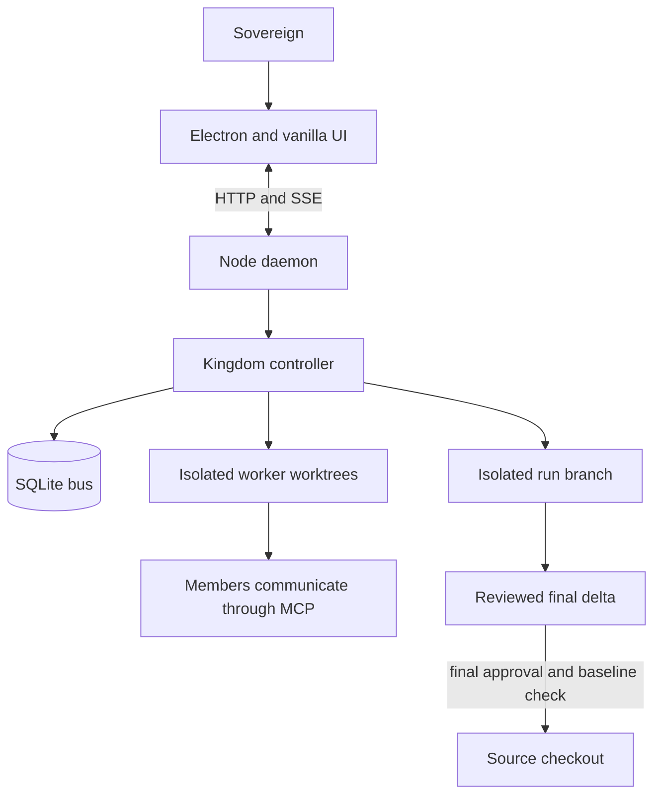
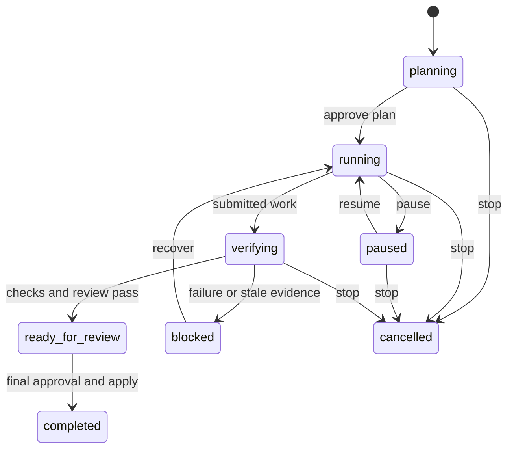

# Agentic OS handoff

## Current state

This is the sole current handoff and operating reference for this repository.
`AGENTS.md`, `CLAUDE.md`, and `docs/HANDOFF.md` point here so an agent does not
act on a stale parallel instruction set.

On 2026-09-06, the autonomous-improvement run system in [PLAN.md](PLAN.md) was
implemented on `functionalfix` and is awaiting the authorized commit/merge
sequence. The implementation has not been demonstrated in a browser or Electron
window yet. The Habitable pilot has not begun; it requires a fresh isolated
snapshot and an evidence-backed backlog before any app implementation starts.

The combined source gate passed: `npm.cmd test` completed **69 suites, 4-wide,
in 64.1 seconds**. `git diff --check` and focused run, daemon, task, prompt,
worktree, store, thread, and review checks also passed. This is source and
HTTP-level evidence, not visual/Electron or live-subscription-agent proof.

## What the application does

Agentic OS is a local multi-agent coding orchestrator. An Electron shell hosts a
vanilla JavaScript UI; a Node daemon owns the court, HTTP/SSE transport, and
SQLite state; members work in Git worktrees and communicate directly through
MCP. State lives outside a target repository in its `.kingdom` directory.



The new run record is durable and contains the source snapshot, approved plan,
acceptance criteria, allowed models, associated tasks, recovery history, and
revision-bound verification evidence. Its states are `planning`, `running`,
`paused`, `blocked`, `verifying`, `ready_for_review`, `completed`, and
`cancelled`.



## Implemented run behavior

- SQLite migrations add runs and nullable task, approval, and message run IDs
  without changing existing rows.
- Run HTTP actions and SSE snapshots expose creation, approval, pause, stop,
  resume, apply, and current/history reads.
- A run creates an isolated integration worktree. Accepted worker revisions
  merge there only after tests identify the exact checked revision.
- Run-owned `finish_task` submits work for verification; it does not mark the
  task done. Failed or stale evidence blocks the run with preserved work and a
  next action.
- Recovery history persists. Repeated unresolved worker failure becomes a
  visible blocker while unrelated work can continue.
- Pause stops new turns. Stop terminates only run-owned members. Restart
  reconciles an active run worktree before work resumes.
- Final Apply requires a ready-for-review run, final approval, a clean source
  checkout, and an unchanged captured baseline. It merges the run branch only
  after in-memory conflict checking.
- Overview, thread, and Changes show objective, work, progress, blockers,
  recovery, evidence, final review, limitations, walkthrough steps, and the
  source-state comparison.

## Key files

| File | Responsibility |
|---|---|
| [src/bus.js](src/bus.js) | SQLite schema, migrations, run lifecycle, task and approval associations. |
| [src/kingdom.js](src/kingdom.js) | Worker lifecycle, recovery, verification, run worktrees, and guarded application. |
| [src/worktree.js](src/worktree.js) | Worktree creation, revision-bound tests, conflict-safe integration, and run-branch application. |
| [src/daemon.js](src/daemon.js) | HTTP actions, run reads, snapshots, and SSE run events. |
| [src/mcp/tasks.js](src/mcp/tasks.js) | Run-owned task submission and controller-owned closure. |
| [src/mcp/approvals.js](src/mcp/approvals.js), [src/mcp/comms.js](src/mcp/comms.js) | Run association for approvals and direct messages. |
| [ui/run.js](ui/run.js) | Run status, controls, final-review evidence, and rendering helpers. |
| [ui/store.js](ui/store.js) | Shared live run state. |
| [ui/views/home.js](ui/views/home.js), [ui/thread.js](ui/thread.js), [ui/views/changes.js](ui/views/changes.js) | Overview, thread context, and final-review surfaces. |
| [test/t-tasks.js](test/t-tasks.js), [test/t-daemon-boot.js](test/t-daemon-boot.js), [test/t-merge.js](test/t-merge.js) | Run task, action/restart, and guarded-apply regressions. |

## Commands and evidence

```powershell
npm.cmd test
node test/t-tasks.js
node test/t-daemon-boot.js
node test/t-merge.js
node test/t-tool-surface.js
node test/t-prompt.js
node ui/run.js
git diff --check
```

`npm test` deliberately excludes `t-agent.js` and `t-comms.js` because they
spend real subscription quota. Do not call a test pass visual, Electron, device,
signing, provider, or human-acceptance evidence.

## Operating rules

1. Extend the existing owning suite for every behavior change. A test must
   fail without its fix. Run the complete no-quota suite to its terminal
   summary before committing.
2. Measure before changing thresholds. Put the measurement beside the value.
3. Degrade visibly. A failed spawn, test, merge, tool, or provider must close
   the turn with preserved work and a concrete next action.
4. Preserve dirty source checkouts. A run applies only its delta after the
   sovereign gives final approval and the captured baseline still matches.
5. Keep direct MCP member-to-member messaging, role/mode filtering, the
   framework-free renderer, and one shared stream/poll lifecycle.
6. Edit each selector at its declaration in `ui/app.css`; do not append override
   blocks. Keep the four-state status dot and `#bg` wash. The removed drawn hall
   and avatars stay removed.
7. Never expose credentials in tracked configuration, UI output, logs, or this
   handoff. Codex needs `danger-full-access` to retain MCP tools; a confining
   Codex sandbox makes a member unable to report back.

## Windows and CLI traps

- Pass Codex prompts on stdin with `codex exec -`; Windows command lines have a
  hard length limit and a synchronous spawn failure otherwise prevents exit
  reporting.
- `codex exec resume` accepts a narrower flag set than `exec`; pass compatible
  configuration through `-c`.
- `agy` can change flags when it self-updates. Check `agy --help` when it exits
  silently.
- Do not use a Node heredoc to write JavaScript containing Windows backslashes.
  Use the patch tool and inspect bytes when a literal path matters.
- The Browser pane has reduced motion. Its screenshots compose only while the
  pane is visible, so visual acceptance must use computed styles or a visible
  Electron/browser session.

## Habitable pilot

The approved first target is `E:\AI\Mobile Apps\Habitable`. Its behavior
authority is `DESIGN.md`; its `AGENTS.md` and `README.md` own operating and
build instructions. It is an offline-first Flutter app with local Drift/SQLite,
local-time scoring, history, notifications, and export/import. Preserve those
boundaries and generated-code ownership.

Before a worker changes Habitable:

1. Create a snapshot that includes tracked dirty work and relevant untracked
   source files, but excludes credentials, build output, caches, and identity.
   Record its manifest and leave the original checkout unchanged.
2. Read its specification, capture fresh `flutter analyze`, `flutter test`,
   handwritten coverage, debug APK, and emulator readiness evidence.
3. Demonstrate existing flows, audit observed defects, and prepare a finite
   backlog. Obtain initial approval for that backlog before implementation.
4. Require analysis, tests, coverage, debug APK, independent review, and
   emulator demonstration of every changed flow. Missing tooling is a visible
   blocker with preserved partial work.

The previous assessment found a dirty Habitable checkout, 32 Dart test files,
and unresolved local Flutter/Android tool discovery. Those are historical
leads, not current proof; refresh them before the snapshot.

## Documentation ownership

- `HANDOFF.md` is the current operational source of truth.
- `PLAN.md` is the agreed product contract and acceptance criteria.
- `README.md` is the public explanation and quick start.
- `AGENTS.md`, `CLAUDE.md`, and `docs/HANDOFF.md` are deliberate pointers to
  this file. Git history retains their former text; do not recreate parallel
  active instruction documents.

## Remaining acceptance work

- Exercise the changed run controls and final review in a visible browser or
  Electron session, including reduced-motion behavior and an actual interactive
  walkthrough. Screenshots alone are insufficient.
- Run the pilot preparation above. Its backlog needs approval before Habitable
  implementation starts; physical-device, signing, store release, and iOS
  remain separate from the pilot unless explicitly added.
- Validate live subscription-model pool behavior without paid API fallback when
  a real approved run is started.
