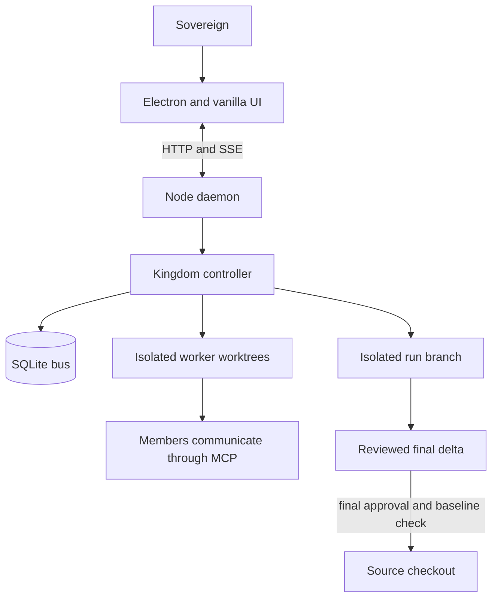
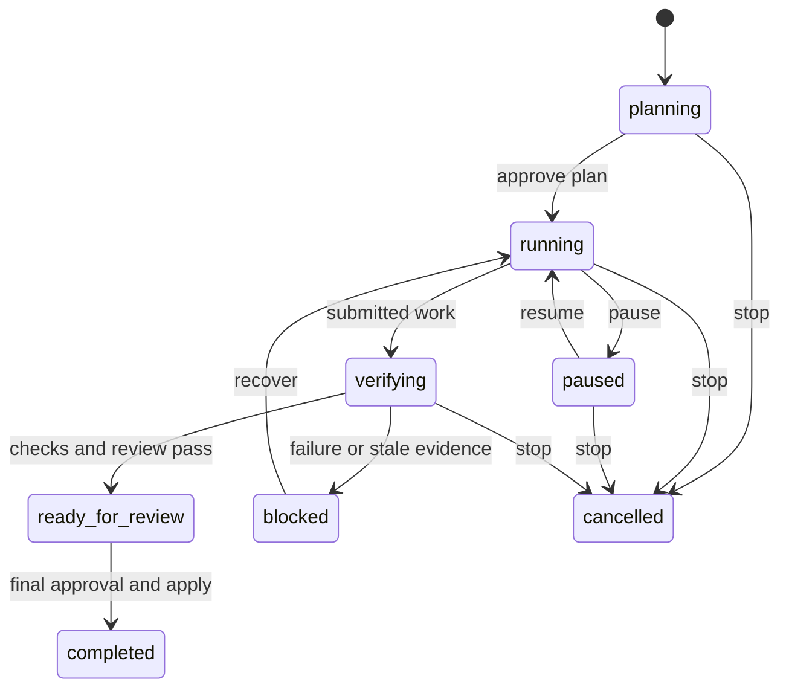

# Agentic OS handoff

## Current state

This is the sole current handoff and operating reference for this repository.
[CLAUDE.md](CLAUDE.md) holds the standing discipline and points here;
`AGENTS.md` and `docs/HANDOFF.md` are pointers, not parallel instruction sets.

On 2026-09-10 the `ui-enhancement` branch was fast-forwarded into `main` and
deleted locally. It carried five UI fixes: sidebar sections no longer overlap
under flex pressure, conversation titles truncate correctly, garbled Windows
`title` tooltips on team rows are replaced by a drawn `.hover-tip`, manual
workflow run results survive store repaints through keyed state instead of a
DOM reference, and the automation graph editor is widened to two columns. Its
`test/t-theme.js` change moved with it.

The push has since happened. Verified 2026-09-21: `main` and `origin/main` are
in sync. `origin` now carries two branches, `main` and `ui-enhancement`; the
other twenty were merged long ago and were deleted on 2026-09-21. The sovereign
chose to keep `ui-enhancement`.

Keep this trap in mind before judging a branch dead or alive: this repository
squash-merges, so a merged branch does NOT appear under
`git branch -r --merged origin/main`. Ancestry is the wrong test. The PR record
is the right one — `gh pr list --state all --json headRefName,state`.

The autonomous-improvement run system is implemented and on `main`, and as of
2026-09-21 it has been driven through its lifecycle in a live browser and in the
Electron shell. The Habitable pilot has not begun.

The approved next body of work is a full interface rebuild. [PLAN.md](PLAN.md)
holds its contract and acceptance criteria.

**Its design system source reversed on 2026-09-21.** The sovereign supplied
`Prototype.zip` — the Cold-Call Workflow kit that PLAN.md section 1 had retired
on 2026-09-17 — and asked for the app redesigned on it outright. That is the
system the app runs now: paper, not a dark shell. Three grounds (`#f7f1e7`,
`#ebe1d2`, `#fffdf9`), one teal accent doing brand and primary interactive
together, the kit's product scale rather than its marketing one (16px card,
12px control, no pill buttons), and metadata set in mono, uppercase and tracked
— which is the exact inverse of the Hiveory rule it replaced. Hiveory's spec
stays in PLAN.md section 1 as the record of what was agreed on 2026-09-17; it
is no longer what the app implements. `ui/app.css`'s `:root` comment says the
same thing at the code, and `test/t-theme.js` pins every value.

Before reading a colour out of the kit: it publishes its contrast ratios
against `--paper` only, and this app's rail and every section sit on
`--paper-deep`. Two tokens are deliberately darker than the kit's
(`--muted`/`--faint` `#55635e`, not `#5c6c66`; `--tone-attention` `#9e4239`,
not `#af4a3f`) so they clear 4.5:1 on the ground they actually sit on. The
suite fails if either is "restored".

**All five sections of that contract are implemented on `main`**, closed
2026-09-21. `PLAN.md` carries the table of what closed each, and now also the
table of how its acceptance clause was met: one live session on 2026-09-21 drove
a run through its lifecycle, recovered a blocked run, exercised the collapsed
rail, the 720px drawer with its keyboard path, and reduced motion — first in a
browser, then confirmed inside Electron.

The redesign re-ran that whole walk on 2026-09-21 and it paid for itself again:
twenty-eight sub-AA contrast pairings, `.conversation-open` at 210x24 and
`.sidebar-repo` at 227x27 against the enforced 44px, the collapsed rail's nav
buttons at 34x44 inside the rail's own 16px inset, the 720px drawer's mode
section reporting 287x0 while its pills painted through the Overview row, and
that drawer running 122px past the viewport and squashing the conversation list
to 287x0 — no way to reach a conversation at all. Every one fixed at its
declaration and pinned. Re-verified live: 14-view audit clean at 1440x900,
collapsed rail 47x44 throughout, Tab trapped across 26 presses in the drawer
with Escape returning focus to Menu, reduced motion correct at both `reduce`
and `no-preference`.

That session is also the strongest argument in this repository for not trusting
source evidence. The interface had 73 green suites and eight visible layout
defects, six of them one root cause: a CSS grid distributes leftover height
across every row it created, so headings floated mid-section and a conversation
row stood 165px tall with 49px left for its title. `align-content: start` at each
shared declaration fixed all six; `fix/live-layout-defects` carries them with
tests that pin the measured numbers.

**2026-09-23: a glass layer was added on top of the paper palette**, on the
`ui-revamp` branch. PLAN.md's new "UI revamp —
paper with glass (2026-09-23)" section is the contract and its acceptance
evidence; the summary: `#header`, `#sidebar` (rail and drawer), `#composer`,
`.hover-tip`, and the drawer scrim gained
`backdrop-filter: blur(20px) saturate(1.6)` and a translucent background at
one of two new alphas (`--glass-chrome-alpha: .90`, `--glass-panel-alpha:
.97`), both computed against a worst-case fully-black wallpaper ground so
every text pairing still clears 4.5:1 there. `.view-section` (cards) stay
flat, unchanged. `test/t-theme.js` intentionally replaces a 2026-09-21 guard
that pinned `backdrop-filter` absent from the whole stylesheet; that guard
predates this direction and is superseded by it, not weakened.

**That first pass audited an empty demo court, and it hid real defects.**
Corrected the same session, in a second round recorded in PLAN.md's "UI
revamp round 2": seeded the demo court with a real objective, a run that
travelled through `blocked` with recovery history plus a second completed
run in history, tasks in every state, three approvals, twelve conversations,
a thread with a real code block and a deliberately long URL, and a real
three-file diff from a summoned peasant's worktree
(`/home/user/wt-ui-shots/seed.mjs`), then re-audited at 1440x900, 1280x720,
and 720x900. Found and fixed five more defects invisible against an empty
state: the rail's footer and conversation list clipped under real height
pressure at 1280x720 (`.sidebar-scroll`); the page heading carried an
identical, information-free eyebrow and the marketing type scale on all 14
views (PLAN.md section 1 requires the product scale); the glass from the
first round was invisible with no wallpaper set, because blurring a flat
colour is indistinguishable from not blurring it (`--wash` gives the paper
itself real tonal variation); Settings' Models & efficiency and Notifications
tabs drew a card nested inside a panel (an outer `.view-section` flush
against its own `.settings-group` fieldsets); and the header's mode switcher
visibly dominated the header with a permission blurb `test/t-theme.js`
already banned once under a different tag name. Also traced and fixed: a
fenced code block in a thread message had no styling at all (bare browser
`<pre><code>` defaults) — `ui/markdown.js` already rendered it correctly, the
gap was purely that `ui/app.css` never styled the result. Checked and left
alone, with reasons recorded in PLAN.md: Settings' tab row (already scrolls,
does not wrap), the Changes diff view (reads well against a real diff), and
Overview's "Verified deliverables" card (measured 173px in real Chromium
against "Current work"'s 350px — a screenshot misreading, not a stretched
card; `align-items: start` was already correct).

## Current state (functional-revamp, 2026-09-23)

On `functional-revamp`, two pieces of the 2026-09-23 "functional revamp" have
landed: multiple courts at once (closes GitHub issue #42) and Habitable pilot
readiness (tooling detection plus an evidence gate, source-side only). Full
contract and acceptance evidence: `PLAN.md`'s "Functional revamp" section.

**Multiple courts reverses the 2026-09-22 decision below** ("Running several
courts... the sovereign declined it for this round") — the sovereign asked for
it explicitly the next day. One daemon process per repository, each on its own
port, tracked in `~/.kingdom/courts.json` (`src/courts.js`); a daemon refuses a
second live court for the same repo and names the port it is on; a busy pinned
port is a clean, visible error; an unpinned port is picked automatically from
7777 up. Electron gets `app.requestSingleInstanceLock()` and per-port windows
(`electron/courts-launch.js`, `electron/main.js`); Settings' Repository panel
gets a switcher (`ui/views/courts.js`) that opens or starts another repo's
court without ending the current one, and no longer waits for attachRepo to
fail before offering "End court and switch…" (issue #42's fail-first
complaint). **Electron itself and Windows were not exercised** — this
environment cannot launch Electron; that acceptance work is still owed.

**Review fix, same day: a LIVE attach bypassed the registry.**
`registerCourt` only ran once, at daemon boot, with whatever repo was known
then — a repo-less daemon that later got `POST /api/attachRepo` (or the
saved-repo re-attach at boot) never updated or conflict-checked the registry.
That let two daemons end up serving the SAME repository with no refusal, and
left a stale `repo: null` row the switcher could never match. Fixed: the
attach handler now claims the repo under the registry's lock BEFORE
`kingdom.attachRepo` does any work, refuses naming the other court's port on
conflict, and rolls back the claim if the attach itself then fails.
`test/t-registry-attach.js` (two real daemons) covers it, confirmed to fail
without the fix.

**Review fix, same day: the test gate itself wrote to the real registry.**
Suites that spawn a real daemon (`t-assets`, `t-control`, `t-csrf`,
`t-daemon-boot`, `t-daemon-conversations`, `t-doctor-api`, `t-multi-court`,
`t-panels`, `t-uploads`, `t-registry-attach`) were registering into the REAL
`~/.kingdom/courts.json` on whatever machine ran `npm test` — on the
sovereign's machine, running the gate while the app is open would have
mutated their live registry. Fixed at the runner: `test/run-all.js` now
spawns every suite with its own isolated `KINGDOM_COURTS_REGISTRY` (one
per-suite temp file, so concurrent suites never share or race over one), and
`test/isolate-registry.js` gives the same isolation to a suite run standalone
(`node test/t-x.js`). `test/t-registry-isolation.js` is the guard, proving a
daemon spawned this way never touches the real file. The file that had
already been created on this machine by earlier, unisolated runs was deleted
once the fix was verified.

Habitable pilot readiness: `src/pilot-doctor.js` (flutter/dart/adb/SDK/emulator
detection, doctor-style) and `src/pilot-evidence.js` (`flutter analyze`,
`flutter test --coverage`, `flutter build apk --debug`, each step recorded
independently), wired into `src/evidence.js` as an optional section. Built and
tested entirely with fakes — no Flutter is installed in this environment, and
neither module reads, runs against, or references the real Habitable checkout
by path. This is steps 2 and 4's machinery only; steps 3-4's actual
demonstration/audit/backlog/review work against Habitable itself is untouched
and still gated on backlog approval, per the section below.

## Evidence

The combined source gate passed on merged `main`: `npm.cmd test` completed
**77 suites, 4-wide, 71.6s, all passed** on 2026-09-22, after four backlog
items landed one at a time with the full gate re-run between each: target-repo
snapshot/restore (`src/snapshot.js`), a per-run spend ceiling plus a projected
total measured from the campaign boundary (`src/kingdom.js`, `src/forecast.js`),
bearer-token auth for a non-loopback daemon bind (`src/daemon.js`), and a
self-contained evidence folder per completed run (`src/evidence.js`). Earlier
handoffs recorded 73 suites; the runner's array has grown by two
(`t-snapshot.js`, `t-evidence.js` — new suites) plus new cases inside two
already-registered suites (`t-efficiency.js`, `t-csrf.js`). #44's fix
(`fix/issue-44-hidden-windows`) adds a third new suite, `test/t-windows-hide.js`
— a static parser guard that every `src/`/`electron/` child_process call
passes `windowsHide: true`. #41's fix (`fix/issue-41-turn-guardrails`) adds a
fourth, `test/t-turn-guardrails.js` (every AWARENESS-styled post is a notice,
the hadRealTurn wiring holds, workflows cannot loop unboundedly), plus new
turn-budget cases inside the already-registered `t-budget.js` — bringing
`npm test` to **79 suites, 4-wide, 40.2s, all passed** with both merged. The
suite count is the contract.
`test/t-electron.js` (the recovered Electron acceptance harness) is not yet in
this count — it lands with PR #71, still open pending manual merge.

On `functional-revamp` (2026-09-23, not yet merged to `main`), the same gate
printed **84 suites, 4-wide, ~37s, all suites passed** after the two review
fixes above landed (each its own commit, full gate green before and after —
see the two "Review fix" paragraphs). The runner's array grew by eight over
`main`: `t-courts.js`, `t-multi-court.js`, `t-courts-launch.js` (issue #42),
`t-pilot-doctor.js`, `t-pilot-evidence.js` (Habitable pilot readiness),
`t-registry-attach.js` (the live-attach fix), `t-registry-isolation.js` (the
test-gate isolation fix), plus new cases inside `t-pages.js` and
`t-evidence.js`. `court registry` and, separately, `a live attach claims the
registry` were each flagged flaky-in-pool-passed-alone on one run apiece —
the same pre-existing pool-contention class `src/courts.js`'s `pingCourt`
timeout comment documents, not a regression (both suites passed cleanly, alone
and in the pool, on other runs the same session). This is source and
real-subprocess HTTP-level evidence only — Electron and Windows are
unverified; see "Current state" above and `PLAN.md`'s "Functional revamp"
section for exactly what is and is not held.

Durations on the same machine: 36.8s (2026-09-14), 64.1s earlier still, 105.8s,
179.6s and 61.2s on 2026-09-21, 68.6-78.7s across the five 2026-09-22
integration runs (four merges plus the final suite-registration run). That
spread is machine load under 4-wide contention, not
regression — `test/run-all.js` documents the same effect and measures it. Do
not treat a slower run as a failure on its own.

`court self-control` failed inside the pool and passed when retried alone on
the 2026-09-21 run. The runner reports that as `flaky`, and it is the one suite
known to do this. Treat a bare pool failure there as unproven until the retry
result is read.

That gate is mostly source and HTTP-level evidence. Two suites in it are not:
`t-theme-geometry.js` reads real computed layout from a real Chromium tab when
one is available, skipping itself otherwise; `test/t-electron.js` launches the
shipped Electron binary against a real daemon and a real temporary repository
and asserts against what Chromium painted, covering the shell (repository,
branch, live stream, the next-step surface) and a run driven through
`planning → running → paused → running → cancelled`. That is automated,
repeatable coverage for part of the interface contract, not the whole of it:
separately, the 2026-09-21 live session supplies one-time visual and Electron
evidence for the full contract, including the three clause items
`test/t-electron.js` does not yet cover — see `PLAN.md`. None of this is
device, signing, provider, or human-acceptance evidence.

## What the application does

Agentic OS is a local multi-agent coding orchestrator. An Electron shell hosts a
vanilla JavaScript UI; a Node daemon owns the court, HTTP/SSE transport, and
SQLite state; members work in Git worktrees and communicate directly through
MCP. State lives outside a target repository in its `.kingdom` directory.



The run record is durable and contains the source snapshot, approved plan,
acceptance criteria, allowed models, associated tasks, recovery history, and
revision-bound verification evidence.



## Implemented run behavior

- SQLite migrations add runs and nullable task, approval, and message run IDs
  without changing existing rows.
- Run HTTP actions and SSE snapshots expose creation, approval, pause, stop,
  resume, apply, and current/history reads.
- A run creates an isolated integration worktree. Accepted worker revisions
  merge there only after tests identify the exact checked revision.
- Run-owned `finish_task` submits work for verification; it does not mark the
  task done. Failed or stale evidence blocks the run with preserved work and a
  next action.
- Recovery history persists. Repeated unresolved worker failure becomes a
  visible blocker while unrelated work can continue.
- Pause stops new turns. Stop terminates only run-owned members. Restart
  reconciles an active run worktree before work resumes.
- Final Apply requires a ready-for-review run, final approval, a clean source
  checkout, and an unchanged captured baseline. It merges the run branch only
  after in-memory conflict checking.
- Overview, thread, and Changes show objective, work, progress, blockers,
  recovery, evidence, final review, limitations, walkthrough steps, and the
  source-state comparison.

## Key files

| File | Responsibility |
|---|---|
| [src/bus.js](src/bus.js) | SQLite schema, migrations, run lifecycle, task and approval associations. |
| [src/kingdom.js](src/kingdom.js) | Worker lifecycle, recovery, verification, run worktrees, and guarded application. |
| [src/worktree.js](src/worktree.js) | Worktree creation, revision-bound tests, conflict-safe integration, and run-branch application. |
| [src/daemon.js](src/daemon.js) | HTTP actions, run reads, snapshots, SSE run events, and bearer-token auth for a non-loopback bind. |
| [src/snapshot.js](src/snapshot.js) | Target-repo snapshot/restore before a worker touches it (Habitable pilot step one). Read-only against the repo it snapshots. |
| [src/evidence.js](src/evidence.js) | Exports one self-contained folder per completed run: objective, diff, tests, reviews, cost, timeline, and an optional pilot section. |
| [src/courts.js](src/courts.js) | Multiple courts at once (issue #42): the `~/.kingdom/courts.json` registry — register/list/prune, port picking, lockfile + atomic write. Pure core is self-checking (`node src/courts.js`). |
| [electron/courts-launch.js](electron/courts-launch.js) | The pure decision behind a relaunch or `app.requestSingleInstanceLock`'s second-instance event: focus a live court or start a fresh one. Self-checking (`node electron/courts-launch.js`); see `test/t-courts-launch.js`. |
| [ui/views/courts.js](ui/views/courts.js) | The court switcher panel in Settings' Repository tab. Degrades to a plain note outside Electron (`window.kingdomShell` absent). |
| [src/pilot-doctor.js](src/pilot-doctor.js) | Habitable pilot step two: doctor-style flutter/dart/adb/SDK/emulator detection. `node src/pilot-doctor.js` for a real report; every dependency is injectable for `test/t-pilot-doctor.js`. |
| [src/pilot-evidence.js](src/pilot-evidence.js) | Habitable pilot steps two and four: the evidence gate — `flutter analyze`, `flutter test --coverage`, a debug APK build, blocked cleanly on missing tooling. Fakes-only in tests; never points at the real Habitable checkout. |
| [test/isolate-registry.js](test/isolate-registry.js) | Shared test helper: gives a daemon-spawning suite an isolated `KINGDOM_COURTS_REGISTRY` when nothing upstream (`test/run-all.js`) already set one — never touches the real `~/.kingdom/courts.json`. |
| [src/modes.js](src/modes.js) | The mode table: crew, worktrees, merge, tasks, vault directory. Pure and self-checking. |
| [src/mcp/tasks.js](src/mcp/tasks.js) | Run-owned task submission and controller-owned closure. |
| [src/mcp/approvals.js](src/mcp/approvals.js), [src/mcp/comms.js](src/mcp/comms.js) | Run association for approvals and direct messages. |
| [ui/app.css](ui/app.css) | The whole design system. Tokens in `:root`; no literal colours outside it. |
| [ui/views/util.js](ui/views/util.js) | The shared view primitives every view composes from. |
| [ui/run.js](ui/run.js) | Run status, controls, final-review evidence, and rendering helpers. |
| [ui/store.js](ui/store.js) | Shared live run state. |
| [ui/main.js](ui/main.js), [ui/sidebar.js](ui/sidebar.js) | Shell: routing, stream lifecycle, header, and the rail. |
| [ui/views/home.js](ui/views/home.js), [ui/thread.js](ui/thread.js), [ui/views/changes.js](ui/views/changes.js) | Overview, thread context, and final-review surfaces. |
| [test/t-theme.js](test/t-theme.js) | The stylesheet contract: pinned tokens, selectors, and the literal-colour ban. |
| [test/t-pages.js](test/t-pages.js) | The view contract. Mostly behavioural guards; treat them as load-bearing. |
| [test/t-thread.js](test/t-thread.js) | Mounts the thread against a hand-rolled fake DOM with literal selectors. |
| [test/t-electron.js](test/t-electron.js) | Launches the real Electron binary with `playwright-core` and reads what Chromium painted. Covers the shell and the run lifecycle; recovery, the collapsed rail, the 720px drawer, and reduced motion are not yet sections here. |
| [test/run-all.js](test/run-all.js) | A hardcoded suite array, not glob discovery. A new suite must be added by hand. |

## Commands and evidence

```powershell
npm.cmd test
npm.cmd start
node test/t-tasks.js
node test/t-daemon-boot.js
node test/t-merge.js
node test/t-tool-surface.js
node test/t-prompt.js
node test/t-theme.js
node test/t-pages.js
node test/t-electron.js
node ui/run.js
git diff --check
```

`npm test` deliberately excludes `t-agent.js` and `t-comms.js` because they
spend real subscription quota.

## Operating rules

1. Extend the existing owning suite for every behavior change. A test must
   fail without its fix. Run the complete no-quota suite to its terminal
   summary before committing.
2. Measure before changing thresholds. Put the measurement beside the value.
3. Degrade visibly. A failed spawn, test, merge, tool, or provider must close
   the turn with preserved work and a concrete next action.
4. Preserve dirty source checkouts. A run applies only its delta after the
   sovereign gives final approval and the captured baseline still matches.
5. Keep direct MCP member-to-member messaging, role/mode filtering, the
   framework-free renderer, and one shared stream/poll lifecycle.
6. Edit each selector at its declaration in `ui/app.css`; do not append override
   blocks. Colour lives only in the `:root` token block, as channel triples where
   alpha is needed. Keep the `#bg` wash. The removed drawn hall and avatars stay
   removed.
7. Never expose credentials in tracked configuration, UI output, logs, or this
   handoff. Codex needs `danger-full-access` to retain MCP tools; a confining
   Codex sandbox makes a member unable to report back.

## Windows and CLI traps

- Pass Codex prompts on stdin with `codex exec -`; Windows command lines have a
  hard length limit and a synchronous spawn failure otherwise prevents exit
  reporting.
- `codex exec resume` accepts a narrower flag set than `exec`; pass compatible
  configuration through `-c`.
- `agy` can change flags when it self-updates. Check `agy --help` when it exits
  silently.
- Do not use a Node heredoc to write JavaScript containing Windows backslashes.
  Use the patch tool and inspect bytes when a literal path matters.
- The Browser pane has reduced motion. Its screenshots compose only while the
  pane is visible, so visual acceptance must use computed styles or a visible
  Electron/browser session.
- Native `title` tooltips render garbled on some Windows/Chromium builds. The
  rail draws its own `.hover-tip` instead; reuse it rather than reintroducing
  `title` for long text.

## Habitable pilot

The approved first target is `E:\AI\Mobile Apps\Habitable`. Its behavior
authority is `DESIGN.md`; its `AGENTS.md` and `README.md` own operating and
build instructions. It is an offline-first Flutter app with local Drift/SQLite,
local-time scoring, history, notifications, and export/import. Preserve those
boundaries and generated-code ownership.

Before a worker changes Habitable:

1. ~~Create a snapshot that includes tracked dirty work and relevant untracked
   source files, but excludes credentials, build output, caches, and identity.
   Record its manifest and leave the original checkout unchanged.~~ Implemented
   2026-09-22: `src/snapshot.js`'s `snapshotRepo`/`restoreSnapshot`, proven
   against the acceptance scenario verbatim in `test/t-snapshot.js` — tracked
   edit, tracked deletion, untracked source (flat and nested), a secret, and a
   build directory. Source evidence only; never run against the real Habitable
   checkout.
2. Read its specification, capture fresh `flutter analyze`, `flutter test`,
   handwritten coverage, debug APK, and emulator readiness evidence.
3. Demonstrate existing flows, audit observed defects, and prepare a finite
   backlog. Obtain initial approval for that backlog before implementation.
4. Require analysis, tests, coverage, debug APK, independent review, and
   emulator demonstration of every changed flow. Missing tooling is a visible
   blocker with preserved partial work.

An earlier assessment found a dirty Habitable checkout, 32 Dart test files, and
unresolved local Flutter/Android tool discovery. Those are historical leads, not
current proof; refresh them before the snapshot.

## Documentation ownership

- `HANDOFF.md` is the current operational source of truth.
- `PLAN.md` is the agreed product contract and acceptance criteria. It currently
  holds the interface rebuild; the superseded run-system contract is in Git
  history.
- `CLAUDE.md` holds the standing discipline and points here.
- `README.md` is the public explanation and quick start.
- `AGENTS.md` points to `CLAUDE.md`; `docs/HANDOFF.md` points here. Git history
  retains their former text. Do not recreate parallel active instruction
  documents.
- `.claude/arms/` and `.claude/skills/` are delegated by this section and hold
  no authority of their own. A router under `.claude/arms/` indexes work by
  domain: paths, and which skill and trap apply. A skill under
  `.claude/skills/` is a procedure loaded when its trigger fires, in the sense
  `src/skills.js` defines — a method invoked on purpose for the task at hand,
  not knowledge and not a standing rule. Neither may state a rule this file,
  `PLAN.md` or the source owns; where such a rule bears on the work, they name
  the file that owns it. Any contradiction with this file or `PLAN.md` is a
  defect in the subordinate document, and this file wins without argument.

## Remaining acceptance work

- ~~Exercise the interface in a visible browser or Electron session.~~ Done
  2026-09-21; `PLAN.md` records what each clause item demonstrated. Method worth
  reusing: the daemon serves the whole UI over HTTP, so a real browser at
  `127.0.0.1:<port>` exercises the same code Electron loads, and Electron
  launched with `--remote-debugging-port` is reachable over CDP for the same
  measurements. The Browser pane still cannot supply this, for the reason in the
  trap above.
- That 2026-09-21 demonstration was a one-time manual session, not a repeatable
  suite. `test/t-electron.js` (recovered 2026-09-22) turns the shell and the run
  lifecycle into automated Electron evidence that runs on every `npm test`.
  Four clause items are still manual-only and each needs a section in that same
  suite: a blocked run's recovery, the collapsed rail's controls, the drawer at
  720px with its keyboard path, and reduced-motion behaviour — the last two need
  `page.setViewportSize` and `page.emulateMedia({ reducedMotion: 'reduce' })`
  rather than anything new.
- **Confirm `t-electron.js` runs on the Windows CI runner.** It passes locally
  and has never run in Actions. A GitHub `windows-latest` runner is expected to
  launch Electron, but that is unverified here; if it cannot, the suite needs a
  skip guard rather than a red build.
- ~~Measure the collapsed rail's tap targets.~~ Done 2026-09-21. The conflict
  between the pinned 64px rail width and the pinned 44px minimum was real and
  resolved without moving either: the rail's own 16px inset drops to 8px when
  collapsed, which was the only axis with slack. Buttons now measure 47x44 and
  the rail is still 64px. Both numbers are pinned in `test/t-theme.js`.
- Watch the two fixes in `6bec8c8` in a live court. Both are proven by source
  tests only: that the crown's replies now reach an orchestrator whose name is
  "orchestrator", and that releasing a departed member's work names the
  verification it discarded instead of silently collapsing it.
- Run the Habitable pilot preparation above. Its backlog needs approval before
  implementation starts; physical-device, signing, store release, and iOS remain
  separate from the pilot unless explicitly added.
- Validate live subscription-model pool behavior without paid API fallback when
  a real approved run is started.
- Multiple courts at once (issue #42, `functional-revamp`, 2026-09-23) needs
  Electron and Windows acceptance: the single-instance lock, per-port windows,
  the native "End court?" confirmations, and media-permission scoping per
  court window were never run — this environment cannot launch Electron. A
  developer machine must exercise: two repositories open at once, a relaunch
  focusing the right court instead of starting a stray daemon, and the
  switcher's open/end actions in a real window.
- The Habitable pilot's tooling doctor and evidence gate (steps two and four,
  `functional-revamp`, 2026-09-23) are built and tested with fakes only. They
  have never run against real Flutter/Android tooling or the real Habitable
  checkout, and must not until HANDOFF.md step 3 (demonstrate, audit, get a
  finite backlog approved) has actually happened.
