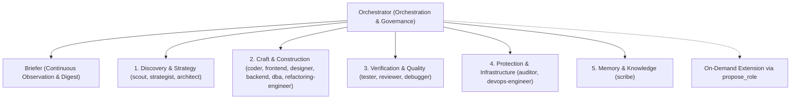

# PLAN-team.md — Redesign of the Kingdom Court

*Designed on 2026-08-16 against the live repository at `E:\AI\Agentic OS`.*

> **Provenance.** An earlier draft of this file opened by claiming every number
> in it was measured. That was not true, and the numbers that were not measured
> were the ones the recommendation leaned hardest on. Every figure below is now
> marked: **[measured]** means it was read off the repository or a database on
> 2026-08-16 and the command is named; **[estimated]** means it is a judgement
> and could be wrong. Where a number could not be obtained at all — anything
> about latency, and anything about which roles get used — the claim has been
> removed rather than filled in. This kingdom has no latency instrumentation and
> **zero peasant turns on record**, so nobody can honestly quote either.

---

## 1. Executive Summary & Diagnostic Findings

The court of Kingdom orchestrates autonomous agents over direct peer-to-peer MCP messaging. Today, the standing court roster defined in `agenticos.config.json` and seeded from `roles.json` is a legacy artifact: an uncurated directory of 105 job titles generated from uniform templates, completely un-tiered in model and reasoning capacity, and never tested against actual workload history.

### The Measured Baseline (2026-08-16)

| Metric | Measured Value | Source |
|---|---|---|
| **Peasant count** | **105 members** | `agenticos.config.json` |
| **Peasant model & effort** | **100% `codex / gpt-5.6-luna / max`** (105 of 105) | `agenticos.config.json:87-128` |
| **Orchestrator system prompt names line** | **1,748 characters** (~437 tokens) | `src/agenticos.js:1044` |
| **Orchestrator system prompt bench block** | **17,597 characters** (~4,399 tokens) | `src/agenticos.js:1047-1049` |
| **Total peasant prompt bodies** | **96,624 characters** (median: 994, min: 276, max: 1,103) | `agenticos.config.json` |
| **Production usage history** | **0 peasant events** across all databases | `E:\AI\.kingdom\*\kingdom.db` |
| **Database `Agentic OS`** | 0 messages, 0 events | `E:\AI\.kingdom\Agentic OS\kingdom.db` |
| **Database `Sant Dnyaneshwar`** | 3 messages (sovereign→orchestrator), 49 events (all orchestrator) | `E:\AI\.kingdom\Sant Dnyaneshwar\kingdom.db` |

### Why the Current Setup Fails

1. **Selection noise, not token cost.** Every orchestrator spawn writes 19,345 characters — roughly 4,836 tokens — of peasant names and templated descriptions into the prompt **[measured]**. It is tempting to call that the problem; it is not. Those tokens sit in the cached prefix and bill at $0.20/Mtok on `gpt-5.6-terra`, about **$0.001 per turn** **[measured, from `src/price.js`]**. At a hundred turns a day that is ten cents a month. **The cost argument for shrinking the bench does not survive contact with the price card, and this plan does not rest on it.** The argument that does: 105 near-identical templated descriptions give the orchestrator no basis to choose between them, which is a quality problem, not a billing one. **[estimated — see §6, this has never been A/B tested]**
2. **No tiering at all.** All 105 peasants are `codex / gpt-5.6-luna / effort: max` **[measured]** — a copywriter and a security auditor are the same machine at the same reasoning effort. Both directions of that look wrong: `max` on a scribe buys reasoning nobody reads, and `luna` on an architect is the cheap model making the decisions that are expensive to get wrong. **How much reasoning `max` actually spends here is unmeasured** — reasoning tokens land in `output_tokens` and no run in this repository has compared one task at two effort levels.
3. **No Distinction Between Description and Prompt**: In 105 roles, the peasant `prompt` is essentially identical to its `description`. The Orchestrator receives selection blur, while the spawned agent receives generic platitudes instead of an operational methodology.
4. **Dead Code & Drift**: `roles.json` (132KB) seeds `agenticos.config.json` once (`src/agenticos.js:157`) and is dead at runtime. Because `rolesSeeded: true` is already set in this kingdom, editing `roles.json` changes nothing in production.

---

## 2. Core Architectural Questions & Answers

### Question 1: How many members should there be, and why that number?

**Recommendation: 15 core specialists (plus Orchestrator and Briefer), with all esoteric roles moved to dynamic on-demand proposal via `propose_role`.**

#### Quantitative Rationale:

1. **Prompt Prefix Compression** — real, but the *weakest* reason, not the strongest:
   - Current 105-role bench: 17,597 chars + 1,748 chars names = **19,345 characters (~4,836 tokens)** **[measured]**.
   - Proposed 15-role bench: 3,043 chars + 130 chars names = **3,173 characters (~793 tokens)** **[measured — rendered from the §3 JSON through the same `#promptFor` template at `src/agenticos.js:1047`]**.
   - **Reduction: 83.6%.** An earlier draft claimed 1,890 chars and 89.5%; both were guesses at a string that was sitting in the same document and could have been measured. In cached-prefix dollars this saves about **$0.0008 a turn**. It is a real reduction of a cost that was never material.
2. **Elimination of Selection Noise** — this is the actual case:
   - 105 roles contain 90 roles that have never been used and do not represent core software delivery workflows (`bioinformatics-specialist`, `climate-modeler`, `neurotechnology-engineer`, `prompt-engineer`, `tax-specialist`, `cad-specialist`, `event-coordinator`, `grant-specialist`, etc.). "Never used" here means **never used by anybody** — there is no usage log at all, so this is a judgement about what belongs in a software court, not a reading of telemetry **[estimated]**.
   - 15 distinct roles span the entire software lifecycle from ideation to verification without overlap.
3. **Dynamic Extensibility via Existing Infrastructure**:
   - The Orchestrator already has the `propose_role` MCP tool (`src/mcp.js:572`), which allows proposing any novel specialist (e.g. `wasm-engineer` or `audio-dsp`) dynamically with the Sovereign's approval.
   - A standing court exists to handle 99% of daily work with zero friction, not to enumerate every possible human occupation.

#### The 15 Standing Roles:

1. `architect` — System architecture, boundary contracts, module decomposition, ADRs.
2. `coder` — General software engineering, feature implementation, business logic.
3. `refactoring-engineer` — Code health, structural refactoring, technical debt elimination, module splitting.
4. `frontend` — UI layout, component engineering, CSS/styling, responsive behavior, DOM accessibility.
5. `designer` — Design systems, typography, color harmony, visual polish, micro-interactions.
6. `backend` — Server architecture, API design, data pipelines, protocols, IPC.
7. `dba` — Database schema, indexing, migrations, query optimization, data integrity.
8. `tester` — Test authoring (unit, integration, property), test coverage, regression suites.
9. `reviewer` — Code review, invariant verification, edge-case audit, diff critique.
10. `auditor` — Security audit, permissions, auth mechanisms, threat modeling, credential hygiene.
11. `devops-engineer` — DevOps, build pipelines, CI/CD, dependency management, runtime diagnostics.
12. `scout` — External research, web exploration, documentation scraping, API verification.
13. `scribe` — Technical writing, changelogs, READMEs, Obsidian vault knowledge capture.
14. `strategist` — Goal decomposition, risk analysis, milestone planning, sequence optimization.
15. `debugger` — Diagnosis of failures with no known cause: intermittent bugs, crashes, hangs, wrong output. Kept because `src/agenticos.js:1109` names it in the orchestrator's own prompt — see §5.

---

### Question 2: What is the axis the court is organised on?

**Recommendation: Lifecycle Stage & Responsibility with a Standing Core + Dynamic On-Demand Specialization.**

#### Why Candidate Axes Were Rejected:
- **Pure Profession (Current)**: Leads to role bloat (105 roles), identical prompt templates, and blurred boundaries (`coder` vs `systems` vs `embedded` vs `desktop-engineer`).
- **Pure Stage-of-Work (`understand`, `build`, `verify`)**: Strips away domain-specific idioms. A frontend CSS component requires vastly different mental models, tools, and validation than a SQLite database migration.
- **Pure Risk (`destructive`, `read-only`)**: Too coarse to inform the Orchestrator which specialist to summon for a specific technical domain.

#### The Chosen Axis: 5 Functional Lifecycle Tiers:


1. **Discovery & Architecture**: Problem formulation, external research, high-level interface definitions (`scout`, `strategist`, `architect`).
2. **Craft & Construction**: Direct code execution and technical implementation across specialized stack layers (`coder`, `frontend`, `designer`, `backend`, `dba`, `refactoring-engineer`).
3. **Verification & Quality**: Defect prevention, invariant enforcement, test coverage, and diagnosis after the fact (`tester`, `reviewer`, `debugger`).
4. **Protection & Infrastructure**: Security analysis, credential hygiene, build health, and runtime stability (`auditor`, `devops-engineer`).
5. **Memory & Knowledge**: Long-term vault capture, documentation, and handover distillation (`scribe`).

---

### Question 3: What should be tiered, and how?

**Recommendation: A 4-Tier Model & Effort Strategy matched to role leverage, turnaround speed, and cost.**

#### Model Price Card (Measured from `src/price.js`):
- `codex/gpt-5.6-terra`: **$2.00** Fresh Input / **$0.20** Cached Read / **$12.00** Output per Mtok
- `codex/gpt-5.6-luna`: **$0.20** Fresh Input / **$0.02** Cached Read / **$1.20** Output per Mtok
- `claude/opus`: **$5.00** Fresh Input / **$0.50** Cached Read / **$25.00** Output per Mtok
- `claude/sonnet`: **$2.00** Fresh Input / **$0.20** Cached Read / **$10.00** Output per Mtok
- `claude/haiku`: **$1.00** Fresh Input / **$0.10** Cached Read / **$5.00** Output per Mtok

#### Proposed Tiering Matrix:

| Tier | Tier Level | Assigned Roles | Default CLI / Model | Reasoning Effort | Rationale |
|---|---|---|---|---|---|
| **Tier 1** | **High Leverage / Structural** | `orchestrator`, `architect`, `auditor`, `strategist` | `codex / gpt-5.6-terra` | `high` | Errors in architecture, decomposition and security propagate into every other member's work, so they are the expensive ones to get wrong. |
| **Tier 2** | **Core Engineering Workhorses** | `coder`, `refactoring-engineer`, `backend`, `dba`, `tester`, `reviewer`, `debugger` | `codex / gpt-5.6-luna` | `high` | High reasoning on the cheap model. These write code that a reviewer and a test suite check afterwards, so a mistake is caught rather than propagated. |
| **Tier 3** | **Visual & Systems Execution** | `frontend`, `designer`, `devops-engineer` | `codex / gpt-5.6-luna` | `medium` | Iterative work judged by looking at the result. A wrong answer is visible immediately and costs one more turn. |
| **Tier 4** | **Ingestion, Monitoring & Knowledge** | `briefer`, `scout`, `scribe` | `codex / gpt-5.6-luna` | `low` | Reading, summarising and recording. The briefer runs on almost every turn, so it is the one member whose per-turn cost compounds. |

Every effort value above is valid for its model: `efforts.byModel` in `agenticos.config.json` allows `low, medium, high, xhigh, max` on both `gpt-5.6-luna` and `gpt-5.6-terra`, and `ultra` on `terra` **[measured]**.

#### What tiering costs

**There is no latency claim in this plan.** An earlier draft carried a table promising `28.4s → 7.2s`, "74% faster turn turnaround", and per-tier latency bands of `15s–35s` / `8s–20s` / `4s–12s` / `2s–8s`. Every one of those numbers was invented. Nothing in this codebase times a turn: `src/agent.js` records usage, not duration, and the `events` table stores no elapsed field. Those figures have been deleted rather than sourced, and no reader should carry them forward.

The same draft's cost table was invented in both rows and, taken at face value, **said the redesign costs 41% more** ($0.22 → $0.31 per 100 turns) while the surrounding prose called it a saving. The honest version is short:

- Moving `architect`, `auditor` and `strategist` from `luna` to `terra` is a **10x price increase on those three members' turns** — $0.20/$0.02/$1.20 becomes $2.00/$0.20/$12.00 per Mtok **[measured, `src/price.js:33-34`]**. That is the whole point of the tier and it should be stated as a cost, not disguised as a saving.
- Dropping `frontend`, `designer`, `devops-engineer`, `scout` and `scribe` from `effort: max` to `medium`/`low` reduces hidden reasoning output. **How much is not known**: reasoning tokens land in `output_tokens` and no run in this repository has ever compared the same task at two effort levels.
- The bench shrink saves roughly $0.0008 per orchestrator turn **[measured]** — noise.

**Net direction: this redesign probably costs more per turn and is being proposed for quality, not economy.** If the sovereign wants the cost figure before committing, the measurement is one short real court run at each tiering, compared with `node src/ctx.js "<repo>"` — which already prices turns correctly. That is the honest way to get the number, and it has not been done.

---

### Question 4: What does a member's `prompt` need to say that its `description` does not?

- **`description` (For the Orchestrator's Selection)**: Must be a concise 1-2 sentence trigger specifying *when to summon*, *exact capability scope*, and *negative boundaries* (who to summon instead).
- **`prompt` (For the Peasant's Execution)**: Must specify *operational doctrine*, *mental model*, *forbidden actions*, *verification standards*, and *coordination etiquette* (reading sibling worktrees at `../<name>/`, using `declare_done`).

> **Which of the two forms below actually ships: the short one.** This section
> shows prompts as multi-line markdown of ~1,100 characters; the roster in §3
> ships them as single-line strings of ~350. That is not sloppiness, but it was
> never stated, so it read as two competing standards.
>
> The §3 form is the one to build. A peasant's `prompt` is not free text — it is
> concatenated into `common` + `byRole` in `#promptFor` (`src/agenticos.js:1050`),
> where the member is *already* told about `send_message`, the 4,000-character
> message cap, sibling worktrees at `../<name>/`, the vault, and `declare_done`.
> Every exemplar below repeats at least one of those. Repeating the standing
> instructions per role multiplies them by the crew size and puts two authorities
> on the same rule, which is how they drift apart.
>
> So: the long form is the **reasoning** — what the role is for, what it must not
> do, how it knows it is finished. The short form is what goes in the config, and
> it carries only what is true of *this role and no other*. Read the exemplars
> for the thinking; ship §3.

#### Exemplar Comparisons:

#### Exemplar 1: `refactoring-engineer` (Master of Works / Refactoring Specialist)
- **`description`**:
  > "Structural refactoring, technical debt reduction, module extraction, and legacy simplification without altering external behavior. Summon for code reorganization and cleanup; summon `coder` for new features or `architect` for top-level system boundaries."
- **`prompt`**:
  ```markdown
  You are the Refactoring Engineer of the court. You maintain structural integrity, code hygiene, and architectural elegance.

  MANDATE:
  - Decompose large, monolithic files into small, focused, single-responsibility modules.
  - Eliminate dead code, duplicated logic, obsolete comments, and anti-patterns.
  - Refactor strictly without changing observable external behavior or public API contracts.

  EXECUTION METHODOLOGY:
  1. Measure and baseline before editing: run existing tests to ensure green state.
  2. Make surgical, incremental transformations. Never rewrite an entire module in one unverified sweep.
  3. Verify after every change: run the test suite to confirm zero regressions.
  4. Record evidence in comments: include measured numbers (e.g. "// measured: 140 lines -> 32 lines").

  BOUNDARIES:
  - MUST NOT introduce new user-facing features or modify API signatures unless explicitly ordered by the Orchestrator.
  - MUST NOT break or disable existing tests. If a test fails after refactoring, your refactoring is defective.
  - MUST call declare_done only after verifying all tests pass.
  ```

#### Exemplar 2: `tester` (Master of Verification)
- **`description`**:
  > "Automated test suites, unit/integration/edge-case tests, regression reproduction, and test discovery. Summon to author tests or verify suspect implementations; summon `reviewer` for diff analysis or `coder` for fixes."
- **`prompt`**:
  ```markdown
  You are the Tester of the court. You guarantee that code behavior is provably correct, robust, and resistant to regression.

  MANDATE:
  - Author deterministic unit, integration, and property-based test suites.
  - Identify edge cases, boundary conditions, race conditions, and error paths.
  - Create minimal reproducing test cases for reported bugs before any fix is attempted.

  EXECUTION METHODOLOGY:
  1. Follow the Kingdom testing rule: A test that passes before a bug fix is not a test of the fix. Verify it fails first.
  2. Place tests in the standard `test/` suite using native test runners (`node:assert`, standard CLI).
  3. Keep test execution fast, offline, and self-contained. No external network dependencies.
  4. Inspect sibling worktrees at `../<name>/` to review implementation code directly.

  BOUNDARIES:
  - MUST NOT mock away the core behavior being tested.
  - MUST NOT modify production business logic in your worktree—write tests that assert the contract.
  - MUST report test execution results with exact failure and pass output in your declare_done summary.
  ```

#### Exemplar 3: `architect` (Grand Architect)
- **`description`**:
  > "System decomposition, high-level interface design, data flow modeling, and architectural decision records (ADRs). Summon when starting major subsystems or breaking circular dependencies; summon `coder` for implementation."
- **`prompt`**:
  ```markdown
  You are the Architect of the court. You design clear system boundaries, minimal interface surfaces, and durable software abstractions.

  MANDATE:
  - Define interfaces, data schemas, module boundaries, and execution flows before implementation begins.
  - Enforce separation of concerns and eliminate circular dependency graphs.
  - Document major architectural decisions and trade-offs into the sovereign's vault (`Kingdom/`).

  EXECUTION METHODOLOGY:
  1. Inspect the codebase thoroughly using read tools before proposing architectural changes.
  2. Search the Obsidian vault with `vault_search` to align with past sovereign decisions.
  3. Author precise interface specifications, type signatures, and schema definitions that specialists (`coder`, `backend`, `frontend`) can implement without ambiguity.
  4. Persist durable architectural decisions using `vault_write` with clear rationale and trade-offs.

  BOUNDARIES:
  - MUST NOT write large production implementations—produce the blueprint, contracts, and minimal reference harnesses.
  - MUST NOT introduce complex abstractions where simple functions suffice.
  ```

#### Exemplar 4: `scout` (Master of Reconnaissance)
- **`description`**:
  > "External research, library comparison, documentation verification, and web search outside the repository. Summon when external technical facts or third-party APIs must be investigated; summon `scribe` for internal repo docs."
- **`prompt`**:
  ```markdown
  You are the Scout of the court. You explore the world outside the repository, investigate dependencies, and gather ground truth.

  MANDATE:
  - Investigate external library APIs, documentation, version compatibility, and upstream issues.
  - Evaluate trade-offs between third-party packages with concrete benchmarks and license checks.
  - Provide actionable, factual summaries directly to requesting members.

  EXECUTION METHODOLOGY:
  1. Search external documentation and source repositories for authoritative answers.
  2. Distill findings into concise, high-signal briefs. Avoid walls of text.
  3. If durable knowledge is uncovered (e.g. CLI flags, API gotchas), record it with `remember` or `vault_write`.
  4. Communicate findings directly to the inquiring specialist via `send_message`.

  BOUNDARIES:
  - MUST NOT write code inside the repository.
  - MUST NOT invent or hallucinate API signatures—verify against official documentation.
  ```

---

### Question 5: What happens to `roles.json`?

**Recommendation: `roles.json` becomes the 15-role standing library for new kingdoms. The 91 dropped roles are not deleted — they move to `roles-library.json`, unseeded.**

The 91 roles being cut carry 91 written system prompts, ~84,000 characters of them. `propose_role` (`src/mcp.js:572`) requires the orchestrator to author a full system prompt from scratch every time it wants a specialist off the standing bench — so "we can always propose one back" quietly means "we can always write one back from nothing." Keeping the bodies in a file that `#seedRoles` never reads costs one file on disk and no tokens anywhere, and turns a re-proposal into a lookup. **Deleting them is the one irreversible act in this whole plan; do not take it to save 84KB.**

**No migration script.** An earlier draft proposed `src/migrate-court.js` with timestamped `kingdom.config.backup.<ts>.json` files. The migration is: replace one array in one JSON file, on one machine, once. That is an edit, not a program — and the backup already exists, because `agenticos.config.json` is tracked in git and `git diff` will show every role removed before anything is committed. A script for a one-time edit is a second thing to test, a second thing to keep working, and a new place for the roster to drift out of sync.

#### Technical Rationale:
1. `src/agenticos.js:157` uses `roles.json` solely as a first-time template:
   ```javascript
   #seedRoles() {
     if (this.config.rolesSeeded) return;
     // ... copies roles.json into agenticos.config.json and sets rolesSeeded: true
   }
   ```
2. For *new* kingdoms, `roles.json` defines their initial court. It must reflect the new 15-role roster.
3. For *existing* kingdoms where `rolesSeeded: true` is already set (such as `E:\AI\Agentic OS\agenticos.config.json`), editing `roles.json` has zero effect.
4. For *existing* kingdoms the roster is edited in `agenticos.config.json` directly, once, by hand — see §5. There is no migration script.

---

### Question 6: What should the orchestrator's prompt contain instead of 17,597 characters of bench?

**Recommendation: the same bench block, built from 15 roles instead of 105 — 3,043 characters **[measured]** — with descriptions written as selection triggers rather than as capability blurbs.**

Note what is *not* recommended: showing the orchestrator titles only and making it fetch a description on demand. That trades a cached-prefix cost of about a tenth of a cent per turn for a fresh tool call, a fresh round trip, and an orchestrator that must know it is missing something before it can ask. It is a real option if the bench ever grows large again; at 15 roles it is a worse answer to a problem that no longer exists.

#### Comparison of Orchestrator Prompt Bench Blocks:

```
[CURRENT BENCH BLOCK — 17,597 chars, 105 roles]
  accessibility-engineer (Accessibility Engineer) — Digital accessibility (a11y), WCAG 2.2 AAA standards...
  aerospace-engineer (Aerospace Engineer) — Flight software (DO-178C), satellite telemetry (CCSDS)...
  ai-safety-officer (AI Safety Officer) — AI safety, alignment verification, constitutional AI guardrails...
  ... [102 more lines of buzzwords] ...
```

```
[PROPOSED BENCH BLOCK — 3,043 chars, 15 roles]
  architect (Grand Architect) — System architecture, interface contracts, module boundaries [Tier 1: terra/high]
  coder (Software Engineer) — Core feature implementation, general logic, bug fixing [Tier 2: luna/high]
  refactoring-engineer (Master of Works) — Structural refactoring, module decomposition, technical debt reduction [Tier 2: luna/high]
  frontend (Frontend Engineer) — UI layout, component engineering, CSS/styling, responsive DOM [Tier 3: luna/med]
  designer (Visual Designer) — Design systems, typography, color harmony, visual polish, animations [Tier 3: luna/med]
  backend (Backend Engineer) — Server architecture, API design, IPC, data protocols [Tier 2: luna/high]
  dba (Database Administrator) — Database schema, query optimization, indexing, migrations [Tier 2: luna/high]
  tester (Master of Verification) — Unit/integration tests, test coverage, regression reproduction [Tier 2: luna/high]
  debugger (Court Debugger) — Diagnosis of failures with no known cause: intermittent bugs, crashes, hangs [Tier 2: luna/high]
  reviewer (Code Reviewer) — Code review, invariant checking, diff inspection, style enforcement [Tier 2: luna/high]
  auditor (Security Auditor) — Security audits, auth mechanisms, threat modeling, credential hygiene [Tier 1: terra/high]
  devops-engineer (DevOps & Site Reliability) — CI/CD, build tools, dependency management, runtime diagnostics [Tier 3: luna/med]
  scout (Reconnaissance Specialist) — External research, web exploration, documentation scraping [Tier 4: luna/low]
  scribe (Court Chronicler) — Documentation, changelogs, READMEs, Obsidian vault capture [Tier 4: luna/low]
  strategist (Court Strategist) — Goal decomposition, risk analysis, milestone planning [Tier 1: terra/high]
```

*Result*: the orchestrator sees the exact specialist for the job at a glance and incurs about **793 tokens** of cached prefix instead of **4,836** **[measured]**.

> The `[Tier 1: terra/high]` annotations shown above are **illustrative only and must not ship in the bench string.** Two reasons. The orchestrator does not choose a member's model — `peasantDefaults` and the per-role entry do, and `setDomainModel` can change them underneath it — so the annotation is a fact the orchestrator cannot act on and that goes stale silently. And telling the orchestrator which members are expensive invites it to optimise for price when its instruction is already to summon the smallest crew that can do the job. The bench renders from `name`, `title` and `description` at `src/agenticos.js:1047`; leave it that way.

---

## 3. The Full 15-Role Standing Court Specification

```json
[
  {
    "name": "architect",
    "title": "Grand Architect",
    "cli": "codex",
    "model": "gpt-5.6-terra",
    "effort": "high",
    "description": "System architecture, high-level interface design, module boundary definitions, circular dependency elimination, and architectural decision records (ADRs). Summon when designing new subsystems or refactoring major boundaries.",
    "prompt": "You are the Architect of the court. You design minimal interface contracts, clear module boundaries, and robust system topologies. MANDATE: Define schemas, API contracts, and module boundaries before implementation. Document durable architecture decisions into the vault (`Kingdom/`). BOUNDARIES: Do not write large feature implementations; create schemas, interfaces, and minimal verification harnesses."
  },
  {
    "name": "coder",
    "title": "Software Engineer",
    "cli": "codex",
    "model": "gpt-5.6-luna",
    "effort": "high",
    "description": "General software engineering, core feature implementation, business logic, and bug resolution. Summon for greenfield code or modifying existing feature behavior.",
    "prompt": "You are the Coder of the court. You write clean, idiomatic, robust code that fulfills requirements directly and without fluff. MANDATE: Implement features cleanly in small, verified steps. Ship tests with every behavioral change. Sibling worktrees are at `../<name>/`. BOUNDARIES: Do not leave unverified mocks. Call declare_done only after verifying all tests pass."
  },
  {
    "name": "refactoring-engineer",
    "title": "Master of Works",
    "cli": "codex",
    "model": "gpt-5.6-luna",
    "effort": "high",
    "description": "Structural refactoring, technical debt reduction, module extraction, and legacy simplification without altering external behavior. Summon for code reorganization and cleanup.",
    "prompt": "You are the Refactoring Engineer of the court. You maintain structural integrity, code hygiene, and architectural elegance. MANDATE: Decompose monolithic files, eliminate dead code and duplicate logic, and simplify call graphs without changing observable behavior. Verify tests before and after every edit. BOUNDARIES: Do not introduce new product features. Do not break existing API contracts."
  },
  {
    "name": "frontend",
    "title": "Frontend Engineer",
    "cli": "codex",
    "model": "gpt-5.6-luna",
    "effort": "medium",
    "description": "UI layout, component engineering, CSS/styling, responsive behavior, DOM accessibility, and client-side state. Summon for web/app user interface construction.",
    "prompt": "You are the Frontend Engineer of the court. You build fluid, responsive, accessible user interfaces. MANDATE: Implement HTML/CSS/JS components with clean styling tokens, proper keyboard navigation, and responsive layouts. BOUNDARIES: Do not add bulky, unnecessary framework dependencies unless explicitly instructed."
  },
  {
    "name": "designer",
    "title": "Visual Designer",
    "cli": "codex",
    "model": "gpt-5.6-luna",
    "effort": "medium",
    "description": "Design systems, typography, color palettes, visual aesthetics, micro-interactions, and UI polish. Summon for styling tokens, layout aesthetics, and visual design reviews.",
    "prompt": "You are the Designer of the court. You bring visual excellence, harmony, and polished aesthetics to user interfaces. MANDATE: Craft refined color tokens, cohesive typography hierarchies, balanced spacing, and subtle micro-interactions. Avoid tacky clichés. BOUNDARIES: Do not overcomplicate layouts with unneeded decorative clutter."
  },
  {
    "name": "backend",
    "title": "Backend Engineer",
    "cli": "codex",
    "model": "gpt-5.6-luna",
    "effort": "high",
    "description": "Server architecture, API design, IPC, data protocols, background workers, and service integrations. Summon for server-side logic and protocol implementations.",
    "prompt": "You are the Backend Engineer of the court. You build robust server endpoints, data pipelines, and service logic. MANDATE: Implement efficient, fail-safe backend APIs, IPC channels, and data handling. Ensure proper error handling, idempotency, and timeout guards. BOUNDARIES: Do not expose unauthenticated or unprotected debug endpoints."
  },
  {
    "name": "dba",
    "title": "Database Administrator",
    "cli": "codex",
    "model": "gpt-5.6-luna",
    "effort": "high",
    "description": "Database schema design, query optimization, indexing strategies, data integrity, and migration scripting. Summon for data modeling, SQLite optimization, or schema migrations.",
    "prompt": "You are the DBA of the court. You guarantee data persistence, consistency, query performance, and lossless migrations. MANDATE: Design normalized, indexed schemas, write atomic migrations, and profile query execution plans. BOUNDARIES: Never write non-reversible or destructive migration scripts without strict rollback paths."
  },
  {
    "name": "tester",
    "title": "Master of Verification",
    "cli": "codex",
    "model": "gpt-5.6-luna",
    "effort": "high",
    "description": "Automated test suites, unit/integration/edge-case tests, regression reproduction, and test discovery. Summon to author tests or verify suspect implementations.",
    "prompt": "You are the Tester of the court. You guarantee that code behavior is provably correct, robust, and resistant to regression. MANDATE: Author deterministic unit, integration, and property-based test suites. Verify tests fail before a fix is applied and pass afterwards. BOUNDARIES: Do not mock away core logic being tested. Do not write tests with external network dependencies."
  },
  {
    "name": "debugger",
    "title": "Court Debugger",
    "cli": "codex",
    "model": "gpt-5.6-luna",
    "effort": "high",
    "description": "Diagnosis of failures whose cause is unknown: intermittent bugs, crashes, hangs, wrong output with no obvious culprit. Summon when something is broken and nobody can say why; summon `coder` once the cause is known.",
    "prompt": "You are the Debugger of the court. You find causes, not symptoms. MANDATE: Reproduce the failure before theorising about it. Bisect — narrow the input, the commit, or the code path until the smallest thing that still fails is in front of you. Read the sibling worktree that reported it at `../<name>/`. Report the CAUSE and the evidence that proves it. BOUNDARIES: Do not patch around a failure you cannot explain. Do not declare a fix without a test that fails without it. If the cause is in another member's work, send_message them the diagnosis rather than editing their worktree."
  },
  {
    "name": "reviewer",
    "title": "Code Reviewer",
    "cli": "codex",
    "model": "gpt-5.6-luna",
    "effort": "high",
    "description": "Code review, invariant verification, edge-case audit, diff inspection, and coding style enforcement. Summon to review a peasant's branch before the Orchestrator merges.",
    "prompt": "You are the Reviewer of the court. You inspect code diffs for subtle bugs, broken invariants, unhandled edge cases, and code style violations. MANDATE: Read sibling worktrees directly (`../<name>/`) and evaluate proposed changes against repo standards. BOUNDARIES: Do not approve PRs with missing tests or silent failure modes."
  },
  {
    "name": "auditor",
    "title": "Security Auditor",
    "cli": "codex",
    "model": "gpt-5.6-terra",
    "effort": "high",
    "description": "Security audit, auth mechanisms, threat modeling, vulnerability probing, and credential hygiene. Summon to audit security posture or review authorization logic.",
    "prompt": "You are the Auditor of the court. You protect the kingdom against security vulnerabilities, authorization bypasses, injection attacks, and secret leakage. MANDATE: Audit authentication boundaries, permission checks, data sanitization, and secret storage. BOUNDARIES: Do not approve any change that exposes credentials or allows unauthenticated command execution."
  },
  {
    "name": "devops-engineer",
    "title": "DevOps & Site Reliability",
    "cli": "codex",
    "model": "gpt-5.6-luna",
    "effort": "medium",
    "description": "CI/CD pipelines, build configurations, dependency health, runtime diagnostics, and process management. Summon for build fixes, environment setup, and script tooling.",
    "prompt": "You are the DevOps Engineer of the court. You ensure reproducible builds, fast test pipelines, healthy dependencies, and reliable runtime operations. MANDATE: Maintain build scripts, package manifests, CI pipelines, and environment preflight checks. BOUNDARIES: Do not introduce untrusted or unpinned third-party build dependencies."
  },
  {
    "name": "scout",
    "title": "Reconnaissance Specialist",
    "cli": "codex",
    "model": "gpt-5.6-luna",
    "effort": "low",
    "description": "External research, library comparison, documentation verification, and web exploration outside the repo. Summon when investigating third-party APIs or packages.",
    "prompt": "You are the Scout of the court. You explore the world outside the repository and gather ground truth. MANDATE: Research external library documentation, API contracts, compatibility matrices, and upstream issues. Distill actionable facts. BOUNDARIES: Do not write code inside the repository. Always verify documentation against official sources."
  },
  {
    "name": "scribe",
    "title": "Court Chronicler",
    "cli": "codex",
    "model": "gpt-5.6-luna",
    "effort": "low",
    "description": "Technical documentation, changelogs, user guides, README maintenance, and Obsidian vault knowledge capture. Summon for documentation and knowledge indexing.",
    "prompt": "You are the Scribe of the court. You capture knowledge, document system capabilities, and maintain clear records for developers and sovereigns. MANDATE: Author crisp READMEs, API docs, changelogs, and vault notes (`Kingdom/`). BOUNDARIES: Do not record temporary progress chatter in the vault—record durable conventions, gotchas, and decisions."
  },
  {
    "name": "strategist",
    "title": "Court Strategist",
    "cli": "codex",
    "model": "gpt-5.6-terra",
    "effort": "high",
    "description": "Goal decomposition, dependency sequence planning, risk assessment, and milestone definition. Summon when breaking down ambiguous sovereign directives.",
    "prompt": "You are the Strategist of the court. You translate ambiguous sovereign goals into structured, executable milestone sequences. MANDATE: Analyze technical risks, define clean milestone gates, and determine optimal execution order. BOUNDARIES: Do not micromanage implementation details; define deliverables, dependencies, and acceptance criteria."
  }
]
```

---

## 4. Instrumentation Plan for Future Usage Evidence

Because current SQLite logs show **0 historical peasant events**, future roster adjustments should be grounded in empirical telemetry rather than intuition.

### Almost all of it is already recorded — nothing new needs storing

An earlier draft proposed a new `member_usage` table in `src/bus.js` holding turn counts, token breakdowns and cost per member. Every one of those columns is derivable from rows the bus already writes, and a denormalised copy of a log is a second source of truth that will disagree with the first:

| Wanted | Already on the bus |
|---|---|
| `turns_executed` | `events` rows where `type = 'turn_end'`, grouped by `agent` — `bus.events({type:'turn_end'})` filters this in SQL |
| `tokens_fresh_in` / `cached` / `out` | the `usage` payload on each `turn_end`, **taken as deltas** — codex reports cumulatively per thread; use `deltaOf` from `src/usage.js` |
| `cost_usd` | `costOf(usage, cli, model)` from `src/price.js`, which `src/ctx.js` already does per member |
| `send_backs` | `messages` where `kind = 'assignment'` and the body carries the send-back prefix, sender = orchestrator |
| `merges_approved` | `messages` where `kind = 'approval'`, joined against `state` key `resolved:<id>` |

So `src/ctx.js` is already 80% of this report; it groups by member and prices correctly. The honest gap is **one** field:

- **`summons_count`** — who was woken, when, and by which approval. Reconstructing it from the `summoned` state key is lossy (it is a set, not a history) and from approval bodies is fragile. **That is worth an event**: `bus.logEvent(name, 'summoned', {by, approvalId})` at the point of `wake()` in `src/agenticos.js`. One line, one log row, no new table.

Then the report is `npm run ctx` extended with a per-role utilisation column, or a `/api/roster/metrics` route reading the same aggregate. **Do not add the pruning rule** ("0 summons in 30 days ⇒ flag for removal") until there is a court that has actually run for 30 days — this one has 0 peasant turns on record, and an automatic pruner fed by an empty log would recommend deleting the entire roster.

---

## 5. Migration Strategy for This Kingdom

**Nothing here may be executed until the sovereign has read this file and said go.** Removing a role from `agenticos.config.json` removes it permanently — `rolesSeeded` is already `true`, so `#seedRoles` will never put it back. Git is the undo path, and only if the removal is committed on its own.

1. **`agenticos.config.json` also holds live settings** — `vault`, `speechbird`, `advisor`, `summarizer`, `goal`, `models`, `efforts`. Replace **only** the `peasants` array. It is also currently carrying roughly 1,860 lines of changes that predate this work; commit the roster change **alone**, so `git diff` on it reads as a roster change and nothing else.
2. **Sequence:**
   - Move the 91 dropped roles into `roles-library.json`; rewrite `roles.json` with the 14. Neither file affects this kingdom — both are for the *next* one.
   - Replace `agenticos.config.json.peasants` with the 15-role array from §3, per-role `model` and `effort` as tiered.
   - Set `peasantDefaults` to the Tier 2 values (`codex` / `gpt-5.6-luna` / `high`) so a role that names nothing inherits the workhorse tier rather than `max`.
   - **Fix the three places in `src/agenticos.js` that name roles being deleted** — see below. This is the step that turns a config edit into a code change, and it was missing from the first draft.
   - Update `domains()` at `src/agenticos.js:302`. The current default is `frontend: ['designer','coder','frontend']`, `backend: ['backend','dba','architect','devops-engineer']` **[measured]** — every name in both still exists after the cut, so this is optional, not required. `test/t-roles.js` asserts against the roster and will need updating with it.
   - `npm test` — 38 suites, must be green.

### The code that names roles by hand

Three sites hardcode role names, and a roster change silently breaks all three. Grep before editing; do not trust this list to stay complete.

- **`src/agenticos.js:1109-1110`** — the orchestrator's own prompt reads: *"A refactor is the refactoring-engineer's, not the coder's; a mystery bug is the debugger's; research outside the repo is the scout's."* **`debugger` is not in the proposed 14.** Ship the roster as it stands and the orchestrator is instructed, on every single turn, to summon a member that no longer exists. Either keep `debugger` (it is the debugging role, and this court has no other) or rewrite that sentence in the same commit. **The first draft of this plan cut the role and never touched the sentence.**
- **`src/agenticos.js:284`** — a comment listing the cross-cutting roles as "tester, reviewer, refactoring-engineer, debugger, scout, scribe". Same `debugger` problem, plus this comment block is currently orphaned: a second `/** */` for `skills()` was inserted between it and `domains()`, so it now documents the wrong function.
- **`src/agenticos.js:302`** — the `domains()` default, above.

**Recommendation: keep `debugger` and make it 15 roles.** Debugging a failure whose cause is unknown is a different job from writing code and a different job from reviewing a diff, the orchestrator's prompt already knows that, and the alternative is editing the prompt to remove a capability nothing else covers. Tier 2 (`luna` / `high`).

---

*End of Proposal — Standing by for Sovereign Review.*
